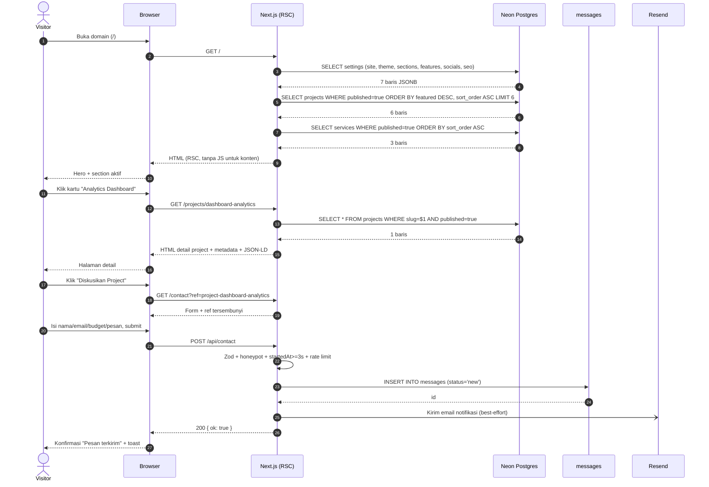
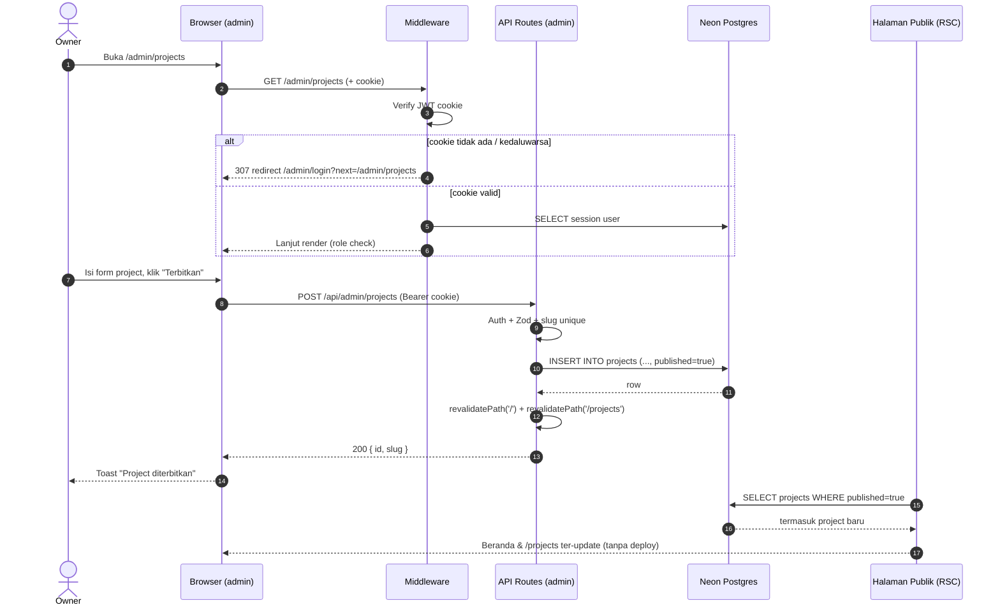
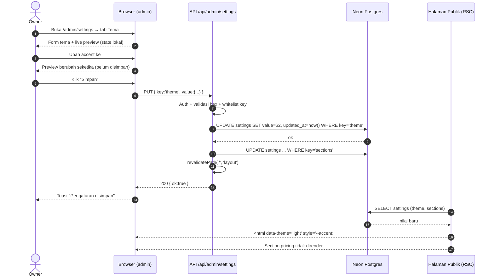
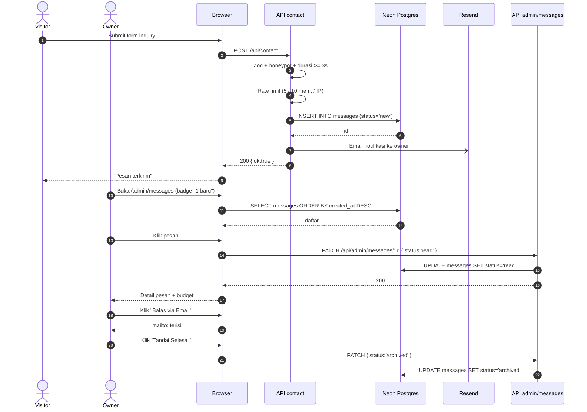
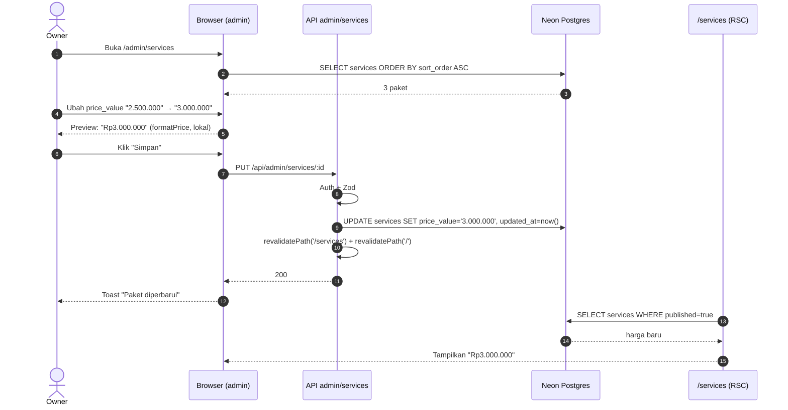
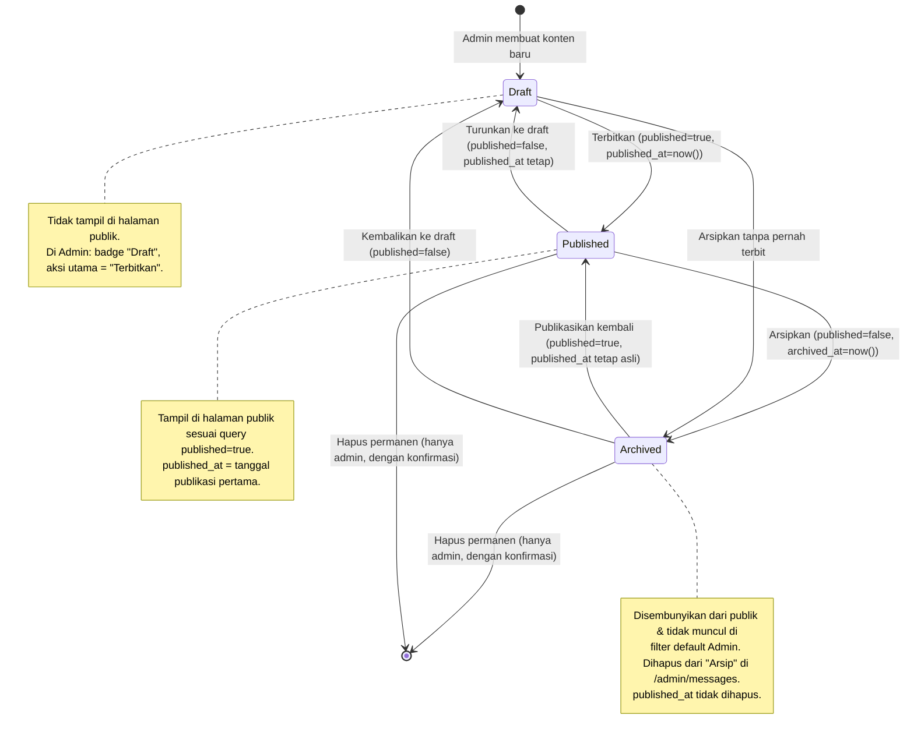

# User Flow: Website Portofolio Pribadi & CMS Semi-Custom

| Atribut | Nilai |
| --- | --- |
| Produk | Website portofolio pribadi + CMS semi-custom |
| Versi dokumen | 1.0 |
| Status | Draft untuk review (Fase 0: Discovery) |
| Tanggal | 4 November 2026 |
| Owner | Developer independen (Indonesia), 1 orang |
| Stack acuan | Next.js 15 App Router · Tailwind v4 · Neon Postgres · Vercel |
| Dokumen terkait | `PROJECT/01-RESEARCH/problem-statement.md` · `PROJECT/05-PLANNING/roadmap.md` · `db/schema.sql` · `db/seed.sql` · `03-DESIGN/design-system.md` · `03-DESIGN/wireframes/` |

---

## 1. Ringkasan & Prinsip

### 1.1 Dua audiens, dua jalur, satu sumber data

Produk ini melayani **dua audiens** dengan dua jalur interaksi yang sama sekali berbeda, tapi berbagi satu sumber kebenaran (Postgres):

| Audiens | Jalur | Tujuan utama | Ukuran sukses |
| --- | --- | --- | --- |
| **Visitor** (calon klien / recruiter / pembaca) | Publik → `/` → `/projects` → `/projects/[slug]` → `/services` → `/contact` | Percaya pada karya, memahami harga, mengirim inquiry | Pesan masuk (`messages` bertambah) |
| **Owner** (pengelola situs) | `/admin/login` → panel admin | Mengubah konten & konfigurasi tanpa deploy | Perubahan terlihat di halaman publik tanpa deploy |

Prinsip yang mengikat seluruh flow di dokumen ini:

1. **Konten adalah data, bukan kode.** Tidak ada flow yang mengharuskan owner menyentuh repository. Satu-satunya pengecualian adalah menambah konten baru lewat form admin.
2. **Tidak ada tombol mati.** Setiap CTA yang terlihat di halaman publik harus punya tujuan: rute internal, `mailto:`, atau WhatsApp link yang valid.
3. **Gagal cepat, jelas, dan reversibel.** Setiap aksi tulis punya: validasi server-side, umpan balik (toast), dan pembatalan yang mudah (confirm dialog).
4. **Tidak ada kehilangan data.** Aksi destructive (hapus project, arsipkan pesan) selalu asks for confirmation dan dapat dipulihkan untuk draft, atau minimal diekspor sebelum dihapus permanen.
5. **Mobile-first pada jalur publik, desktop-first pada jalur admin.** Visitor datang dari WhatsApp di ponsel; owner bekerja di laptop.

### 1.2 Peta rute

**Publik (8 rute)**

```
/                     Beranda: komposisi section toggleable
/projects             Daftar project + filter kategori + paginasi
/projects/[slug]      Detail project (gallery, stack, tautan)
/blog                 Daftar artikel + filter tag
/blog/[slug]          Artikel (markdown, TOC)
/about                Profil, timeline pengalaman, skills, testimonials
/services             Paket jasa + harga (tabel harga, CTA per paket)
/contact              Form inquiry (nama, email, subjek, budget, pesan)
```

**Admin (10 rute)**

```
/admin/login          Login (bcrypt + JWT cookie)
/admin                Dashboard: ringkasan konten & pesan baru
/admin/projects       CRUD project (list + editor)
/admin/posts          CRUD artikel (list + editor markdown)
/admin/services       CRUD paket harga
/admin/experience     Timeline pengalaman kerja
/admin/skills         Daftar skill + level
/admin/testimonials   Testimonial klien
/admin/messages       Kotak masuk inquiry (list + detail + status)
/admin/settings       Pengaturan: site, theme, sections, socials, seo, features, footer
```

### 1.3 Glosarium

| Istilah | Definisi |
| --- | --- |
| **Section toggle** | Sakelar boolean di `settings.sections` yang menentukan sebuah section homepage dirender atau tidak |
| **Publish state** | Status editorial sebuah konten: `draft` → `published` → `archived` |
| **Hire-me banner** | Banner CTA global (`settings.features.hireMe*`) yang muncul di header/footer dan section CTA |
| **Inquiry** | Pesan masuk dari form kontak; FIELD wajib: `budget` |
| **Optimistic update** | UI berubah sebelum respons server, lalu di-revert bila server menolak |
| **Revalidate** | Me-refresh cache halaman publik (`revalidatePath`) setelah konten berubah |

---

## 2. Diagram Overview

### 2.1 Peta navigasi situs publik

```mermaid
flowchart TD
    A[Visitor masuk ke /] --> B{ sectional<br/>dibaca dari settings}
    B -->|sections.hero| C[Hero]
    B -->|sections.services| D[Services ringkas]
    B -->|sections.projects| E[Project grid]
    B -->|sections.testimonials| F[Testimonials]
    B -->|sections.pricing| G[Pricing preview]
    B -->|sections.blog| H[Post terbaru]
    B -->|sections.cta| I[Hire-me banner]

    C -->|heroCtaLink| E
    C -->|heroSecondaryLink| M[Contact]
    D -->|CTA paket| G
    E -->|klik card| J[Project detail]
    J -->|CTA "Diskusikan"| M
    J -->|repo/live link| N[Eksternal]
    G -->|pilih paket| M
    I -->|hireMeButtonLink| M
    H -->|klik judul| O[Artikel]
    O -->|CTA artikel| M
    M[Contact / inquiry] -->|submit| P[(messages)]
    M -.->|alternatif| Q[WhatsApp]
```

### 2.2 Peta dua jalur (publik vs admin)

```
        ┌──────────────────────── PENGUNJUNG (anonim) ────────────────────────┐
        │                                                                   │
        │   / ──▶ /projects ──▶ /projects/[slug]                             │
        │    │        │                                                   │
        │    │        └──▶ /services ──▶ /contact ──▶ [ messages ]          │
        │    │                                ▲                              │
        │    ├──▶ /blog ──▶ /blog/[slug] ────┤                              │
        │    ├──▶ /about                      │                              │
        │    └──▶ /contact ───────────────────┘                              │
        └────────────────────────────────────────────────────────────────────┘
                                      ▲
                        [ settings ] mengatur segalanya
                                      │
        ┌─────────────────────────── OWNER (admin) ──────────────────────────┐
        │   /admin/login ──▶ /admin ──▶ /admin/projects                      │
        │                      │      ├─▶ /admin/posts                       │
        │                      │      ├─▶ /admin/services                    │
        │                      │      ├─▶ /admin/experience                   │
        │                      │      ├─▶ /admin/skills                       │
        │                      │      ├─▶ /admin/testimonials                 │
        │                      │      ├─▶ /admin/messages                     │
        │                      │      └─▶ /admin/settings                     │
        └────────────────────────────────────────────────────────────────────┘
```

---

## 3. Flow A: Visitor menjelajah Beranda (`/`)

| Field | Isi |
| --- | --- |
| **Trigger** | Visitor membuka domain utama, atau klik tautan dari media sosial / pesan WhatsApp / shared link |
| **Actor** | Visitor (anonim, tanpa login) |
| **Precondition** | `settings.sections` sudah diisi (default seed); koneksi DB Neon aktif; tidak ada maintenance flag |
| **Post-condition** | Visitor melihat beranda yang komposisinya ditentukan `settings.sections`; CTA hero dan hire-me menuju rute valid; tidak ada request gagal yang memunculkan section kosong |

### 3.1 Langkah (happy path)

1. Browser meminta `GET /`.
2. Server Component membaca `settings` (key `site`, `theme`, `sections`, `features`, `socials`, `seo`) dalam satu query batch.
3. Layout/Hero membaca `settings.site.heroTitle`, `heroSubtitle`, `heroCtaText`, `heroCtaLink`, `heroSecondaryText`, `heroSecondaryLink`.
4. Server mengevaluasi `settings.sections` satu per satu; section yang bernilai `false` tidak dirender sama sekali (bukan disembunyikan dengan CSS).
5. Section `projects` melakukan query `SELECT ... FROM projects WHERE published = true ORDER BY featured DESC, sort_order ASC LIMIT 6`.
6. Section `pricing` melakukan query paket `published = true ORDER BY sort_order ASC` dan merender `price_value` + `currency` melalui `formatPrice()`.
7. Section `blog` melakukan query `posts WHERE published = true ORDER BY published_at DESC LIMIT 3`.
8. Section `testimonials` melakukan query `testimonials WHERE published = true ORDER BY sort_order ASC LIMIT 3`.
9. Header merender navigasi + tombol CTA hire-me; footer merender social links yang tidak kosong saja.
10. HTML terkirim ke browser; tema diterapkan lewat `<html data-theme>` + CSS variable (`--accent`, `--accent-2`, `--radius-base`).

### 3.2 Diagram alur

```
[Visitor buka /]
       │
       ▼
┌──────────────────────┐
│ Baca settings (7 key)│──► DB error? ──► cache fallback / 503
└──────────┬───────────┘
           ▼
┌──────────────────────┐
│ Render Hero          │  heroCtaLink → validasi rute internal
└──────────┬───────────┘   (harus diawali "/" atau "http")
           ▼
   ┌───────────────┐
   │ sections.hero │ true ? ──no──► skip
   └───────┬───────┘
           ▼
   ┌───────────────┐   setiap section punya gate boolean
   │ sections.*    │──false──► TIDAK dirender (nol DOM)
   └───────┬───────┘
           ▼
   ┌───────────────────────┐
   │ Query konten paralel  │  projects / services / posts / testimonials
   │ (published = true)    │  WHERE + ORDER BY + LIMIT
   └───────┬───────────────┘
           ▼
   ┌───────────────────────┐
   │ Komposisi section     │  gap 24 (mobile) / 32-40 (desktop)
   └───────┬───────────────┘
           ▼
   ┌───────────────────────┐
   │ Header + Footer      │  social link kosong disembunyikan
   └───────────┬───────────┘
               ▼
        [Halaman tampil]
```

### 3.3 Edge case

| Kasus | Penanganan |
| --- | --- |
| `settings.sections.projects = false` | Grid project tidak dirender; tidak ada request DB ke `projects` (hemat query) |
| Guest belum pernah login / tidak ada cookie | Tidak ada personalized content; tampil sebagai anonim |
| `heroCtaLink` menunjuk rute yang tidak ada | Fallback ke `/projects`; CTA tetap hidup, bukan 404 |
| Semua project berstatus `published = false` | Section tetap dirender dengan **empty state** ("Belum ada project yang dipublikasikan") + CTA ke `/contact` |
| Testimonial belum ada | Empty state minimalist, bukan grid kosong yang aneh |
| JavaScript belum termuat (JS disabled / lambat) | Konten tetap terlihat karena RSC; CTA navigation adalah `<a>` biasa, bukan `<button onClick>` |
| Pengunjung membuka beranda 10x dalam 1 menit | Cache `GET /` + `revalidate` berbasis waktu; tidak ada hammer ke Neon |

### 3.4 Error state

| Error | Tampilan | Recover |
| --- | --- | --- |
| Database tidak bisa diakses | Section konten kosong + banner tipis "Konten sedang dimuat ulang" di bawah Hero; halaman tetap 200 | Retry otomatis (revalidate 60s) |
| `settings` key belum ada di DB (fresh DB tanpa seed) | Pakai nilai default dari kode (`DEFAULT_SETTINGS`) | Banner kecil di admin: "Seed belum dijalankan" |
| JavaScript error di client | Konten server tetap tampil | Error log ke console, tidak ada blank page |

---

## 4. Flow B: Visitor membuka Detail Project (`/projects/[slug]`)

| Field | Isi |
| --- | --- |
| **Trigger** | Visitor klik kartu project di `/projects`, di section homepage, atau membuka link langsung yang dibagikan |
| **Actor** | Visitor (anonim) |
| **Precondition** | Project dengan `slug` tersebut ada dan `published = true` |
| **Post-condition** | Halaman detail lengkap tampil; CTA konversi terlihat di atas fold atau setelah gallery; URL dapat dibagikan (canonical) |

### 4.1 Langkah (happy path)

1. Visitor klik `<Link href="/projects/[slug]">` pada `ProjectCard`.
2. Next.js App Router mem-parametrasi route segment `slug`.
3. Server menjalankan `getProjectBySlug(slug)` → `SELECT * FROM projects WHERE slug = $1`.
4. Jika baris tidak ada atau `published = false` → render halaman 404 (`notFound()`), **bukan** halaman kosong.
5. Server merender hero detail: `title`, `summary`, `category` (Badge), `year`, `client`.
6. Cover image dirender lewat `next/image` dengan rasio 16:9, `priority` untuk LCP.
7. `description` (markdown) dirender melalui `react-markdown` + `remark-gfm` dengan sanitasi HTML.
8. `gallery` dirender sebagai grid/carousel; gambar tambahan dimuat lazy.
9. `stack` dirender sebagai Badge list.
10. `repo_url` dan `live_url` dirender sebagai dua tombol: "Lihat Demo" (accent) dan "Source Code" (outline). Kalau kosong → tombolnya tidak dirender.
11. Section CTA "Punya project seperti ini?" + tombol menuju `/contact` dengan query `?ref=project-[slug]` (untuk pelacakan konversi).
12. `generateMetadata()` menghasilkan title, description, OG image, dan JSON-LD `CreativeWork`.

### 4.2 Diagram alur

```
[Klik ProjectCard / buka link]
            │
            ▼
┌────────────────────────┐
│ getProjectBySlug(slug) │
└───────────┬────────────┘
            │
   ┌────────┴─────────┐
   │                  │
 data null /      data ada &
 published=false      │
   │                  │
   ▼                  ▼
┌─────────┐    ┌──────────────────────┐
│ notFound│    │ Render hero detail   │
│ → 404   │    │ title/summary/badge  │
└─────────┘    └──────────┬───────────┘
                          ▼
              ┌──────────────────────┐
              │ Cover image (16:9)   │  priority → LCP
              └──────────┬───────────┘
                          ▼
              ┌──────────────────────┐
              │ Markdown description  │  react-markdown + GFM
              └──────────┬───────────┘
                          ▼
              ┌──────────────────────┐
              │ Gallery              │  lazy load
              └──────────┬───────────┘
                          ▼
              ┌──────────────────────┐
              │ Stack badges         │
              └──────────┬───────────┘
                          ▼
              ┌──────────────────────┐
              │ [Lihat Demo][Source] │  disembunyikan bila URL kosong
              └──────────┬───────────┘
                          ▼
              ┌──────────────────────┐
              │ CTA → /contact?ref=  │  CTA konversi
              └──────────────────────┘
```

### 4.3 Edge case

| Kasus | Penanganan |
| --- | --- |
| `gallery` kosong (`[]`) | Cover image saja; tidak ada area kosong. Grid gallery tidak dirender |
| `gallery` berisi 1 gambar | Tampil sebagai gambar lebar penuh (bukan grid 2 kolom yang bolong) |
| `cover_image` kosong | Placeholder gradient + inisial judul (konsisten dengan kartu list) |
| `repo_url` dan `live_url` keduanya kosong | Dua tombol tidak dirender; section tautan diabaikan total |
| `description` kosong | Section deskripsi diabaikan; hanya summary yang tampil |
| `slug` diubah owner setelah link dibagikan | Link lama → 404. Owner diberi warning "mengganti slug memutus URL lama" di editor |
| Visitor datang dari link preview di WhatsApp | OG image fallback ke `seo.ogImage` bila `cover_image` kosong |
| Gambar gagal dimuat | Placeholder abu-abu + ikon gambar; tidak ada layout shift besar (container rasio tetap) |

### 4.4 Error state

| Error | Tampilan | Recover |
| --- | --- | --- |
| Project tidak ditemukan / tidak published | Halaman 404 dengan tombol "Lihat semua project" dan link WhatsApp | Navigasi manual |
| Galeri rusak (URL 404) | `<Image>` fallback ke placeholder; halaman tetap utuh | Log ke client, ganti URL di admin |
| Query DB gagal | 500 dengan `error.tsx` minimal (bukan stack trace) | Tombol "Coba lagi" |

---

## 5. Flow C: Visitor mengirim Form Kontak / Inquiry (`/contact`)

| Field | Isi |
| --- | --- |
| **Trigger** | Visitor isi form inquiry di `/contact` (dari CTA hero, CTA project, CTA paket harga, CTA artikel, CTA section) |
| **Actor** | Visitor (anonim) |
| **Precondition** | Halaman `/contact` terbuka; `settings.site.email` terisi (untuk notifikasi); rate limit aktif |
| **Post-condition** | Baris baru di tabel `messages` dengan `status = 'new'`; visitor melihat konfirmasi; email notifikasi terkirim ke owner |

### 5.1 Field form

| Field | Tipe | Wajib | Validasi | Sumber |
| --- | --- | --- | --- | --- |
| Nama | text | Ya | min 2, max 100 | `messages.name` |
| Email | email | Ya | format email valid, max 200 | `messages.email` |
| Subjek | text | Tidak | max 150 | `messages.subject` |
| Budget | select | Tidak | salah satu dari preset (lihat §5.4) | `messages.budget` |
| Pesan | textarea | Ya | min 20, max 5000 | `messages.message` |
| Honeypot | text (hidden) |: | harus kosong | ditolak server bila terisi |
| `startedAt` | hidden | Ya | selisih ≥ 3 detik sejak render | anti-bot |
| `ref` | hidden | Tidak | sumber CTA (`?ref=`) | untuk pelacakan |

### 5.2 Langkah (happy path)

1. Visitor membuka `/contact`. Komponen form (Client Component) merender `startedAt = Date.now()`.
2. Visitor mengisi field. Validasi client-side (Zod) memberi inline error per field saat blur / submit.
3. Visitor menekan tombol "Kirim Pesan" → `POST /api/contact` dengan JSON.
4. Server menjalankan validasi Zod **ulang** (client-side bukan sumber kebenaran).
5. Server memeriksa honeypot: terisi → langsung return 200 dengan pesan sukses (tidak menyimpan, tidak membalas error agar bot tidak belajar) dan rate-limit IP.
6. Server memeriksa `startedAt`: durasi < 3 detik → ditolak sebagai bot (422).
7. Server memeriksa rate limit: > 5 pesan / IP / 10 menit → 429.
8. Server menjalankan `INSERT INTO messages (name, email, subject, budget, message, status) VALUES (..., 'new')`.
9. Server mengirim email notifikasi (Resend) ke `CONTACT_TO_EMAIL` berisi ringkasan pesan + tautan `/admin/messages/[id]`.
10. Server return `{ ok: true }`. Client menampilkan state sukses (ikon centang + "Pesan terkirim" + tombol "Kirim pesan lain"), dan history.replaceState ke `/contact?sent=1`.
11. Toast sukses muncul di pojok kanan bawah (variant `success`).
12. Owner menerima email notifikasi; pesan baru muncul di badge `/admin/messages` (belum di-count bila polling belum aktif -^*\ see §5.6).

### 5.3 Diagram alur

```
[Isi form /contact]
        │
        ▼
┌───────────────────────────┐
│ Validasi client (Zod)     │──invalid──► inline error per field
└────────────┬──────────────┘
             ▼
┌───────────────────────────┐
│ POST /api/contact         │
└────────────┬──────────────┘
             ▼
    ┌────────┴─────────┐
    │                  │
honeypot terisi    honeypot kosong
    │                  │
    ▼                  ▼
┌───────────┐   ┌────────────────────┐
│ BUANG     │   │ Cek startedAt ≥3s  │──<3s──► 422 (bot)
│ (200 palsu)│   └─────────┬──────────┘
└───────────┘             ▼
                 ┌────────────────────┐
                 │ Rate limit IP      │──>5/10m──► 429 + pesan ramah
                 └─────────┬──────────┘
                           ▼
                 ┌────────────────────┐
                 │ Zod server-side    │──invalid──► 422 + field errors
                 └─────────┬──────────┘
                           ▼
                 ┌────────────────────┐
                 │ INSERT messages    │──gagal──► 500 "gagal menyimpan"
                 │ status='new'       │
                 └─────────┬──────────┘
                           ▼
                 ┌────────────────────┐
                 │ Kirim email (Resend)│──gagal──► log saja, pesan TETAP tersimpan
                 └─────────┬──────────┘
                           ▼
                 ┌────────────────────┐
                 │ 200 { ok: true }   │──► UI sukses + ?sent=1 + toast
                 └────────────────────┘
```

### 5.4 Edge case

| Kasus | Penanganan |
| --- | --- |
| Budget tidak dipilih | Boleh: field opsional, tersimpan sebagai `''` |
| Budget "Custom / Lainnya" dipilih | Tampilkan textarea opsional "Estimasi budget (IDR)" (client-side reveal), tetap aman bila kosong |
| Pengunjung mengisi sangat cepat (< 3 detik, bot) | Ditolak 422 dengan pesan generik; tidak ada baris tersimpan |
| Honeypot terisi (bot) | Ditolak diam-diam; respons tetap "terima kasih" agar bot tidak terdeteksi; **tidak ada** baris baru di `messages` |
| IP mengirim > 5 pesan / 10 menit | 429 + teks "Terlalu banyak pesan. Coba lagi dalam 10 menit." + tombol WhatsApp sebagai alternatif |
| Email notifikasi gagal (Resend down/quota) | Pesan **tetap** tersimpan; error dicatat di log; owner melihat pesan di dashboard |
| Visitor menekan submit dua kali | Tombol disabled + `isSubmitting` selama request; `idempotency` lewat cek honeypot dua kali & disabled state |
| Visitor menutup tab saat request berjalan | `navigator.sendBeacon` fallback, atau biarkan server menyimpan (lead tetap aman) |
| Pengunjung menyalin pesan lama | `?sent=1` menampilkan konfirmasi; form kosong untuk pesan berikutnya |
| Teks berisi HTML/script | Divalidasi & di-escape; disimpan apa adanya (plain text), ditampilkan escaped di admin |

### 5.5 Error state

| Error | HTTP | Pesan ke user | Recuperasi |
| --- | --- | --- | --- |
| Validasi gagal | 422 | "Periksa kembali field yang ditandai merah" | Fokus otomatis ke field pertama yang error |
| Rate limit | 429 | "Terlalu banyak pesan dari perangkat ini. Coba lagi nanti atau hubungi via WhatsApp." | Tampilkan link WhatsApp |
| Bot terdeteksi (honeypot/time) | 422 / 200 palsu | "Pesan terkirim." (tidak perlu detail) |: |
| DB down | 500 | "Gagal menyimpan. Coba lagi atau hubungi langsung via WhatsApp." | Tombol "Coba lagi" + link WhatsApp |
| Server timeout | 504 | "Server sedang sibuk. Coba lagi sebentar." | Auto-retry 1x lalu manual |

### 5.6 Catatan operasional

- Notifikasi email bersifat **best-effort**. Sumber kebenaran lead tetap tabel `messages`.
- Badge jumlah pesan baru di sidebar admin dihitung dari `status = 'new'`; bila tidak ada polling, nilainya di-refresh saat halaman `/admin` dimuat (cukup untuk Fase 1; polling/websocket masuk Fase 4).

---

## 6. Flow D: Visitor Klik CTA "Hire Me" / Inquiry menuju Paket Harga (`/services`)

| Field | Isi |
| --- | --- |
| **Trigger** | Visitor klik tombol hire-me (header, footer, section CTA, kartu paket) atau banner `features.hireMe*` |
| **Actor** | Visitor (anonim) |
| **Precondition** | `settings.features.hireMeEnabled = true`; `settings.features.showPricing = true`; minimal 1 paket `published = true` |
| **Post-condition** | Visitor melihat daftar paket dengan harga transparan dan dapat memilih paket → prefill form inquiry |

### 6.1 Langkah (happy path)

1. Visitor klik CTA berlabel `settings.features.hireMeButtonText` dengan target `settings.features.hireMeButtonLink`.
2. Link diarahkan ke `/services` (atau `/services#pricing`) bila `showPricing = true`; bila pricing dimatikan → link diarahkan ke `/contact`.
3. Halaman `/services` merender daftar paket dari `services WHERE published = true ORDER BY sort_order ASC`.
4. Setiap paket menampilkan: `title`, `description`, `price_label` ("mulai dari"), `price_value` + `currency` (diformat `formatPrice()`), daftar `features` (JSONB array) sebagai checklist, dan ikon `icon` (lucide-react).
5. Paket dengan `popular = true` mendapat badge "Paling Populer" + border accent + slight scale-up (1.02): **maksimal 1 paket** (edge case §6.3).
6. Setiap kartu punya tombol "Pilih Paket" yang menuju `/contact?package=[slug]&ref=pricing`.
7. Di `/contact`, query `package` memunculkan baris ringkasan paket terpilih (judul + harga) di atas form, dan field budget dipreselect ke rentang harga paket tersebut.
8. Visitor melengkapi form dan mengirim → Flow C.

### 6.2 Diagram alur

```
[CTA hire-me diklik]
        │
        ▼
┌────────────────────────────────┐
│ hireMeEnabled?                 │
└───────┬────────────────────────┘
   false│              │true
        ▼              ▼
  CTA tidak   ┌──────────────────────────┐
  dirender    │ hireMeButtonLink →      │
              │ /services#pricing        │
              │ (atau /contact bila      │
              │  showPricing=false)      │
              └───────────┬──────────────┘
                          ▼
              ┌──────────────────────────┐
              │ /services: render paket  │
              │ published=true           │
              │ sort_order ASC           │
              └───────────┬──────────────┘
                          ▼
              ┌──────────────────────────┐
              │ Kartu paket              │
              │ harga + fitur + tombol   │
              └───────────┬──────────────┘
                          ▼
              ┌──────────────────────────┐
              │ "Pilih Paket"            │
              │ → /contact?package=slug  │
              └───────────┬──────────────┘
                          ▼
              ┌──────────────────────────┐
              │ /contact prefill:        │
              │ ringkasan paket + budget │
              └───────────┬──────────────┘
                          ▼
                   [Flow C: kirim pesan]
```

### 6.3 Edge case

| Kasus | Penanganan |
| --- | --- |
| Semua paket `published = false` | Section pricing render empty state "Paket sedang disiapkan" + CTA WhatsApp. Tidak ada harga kosong |
| `showPricing = false` tapi `hireMeEnabled = true` | CTA hire-me diarahkan ke `/contact`; section pricing di homepage tidak dirender |
| `hireMeEnabled = false` | Banner hire-me tidak dirender di mana pun; header tetap menampilkan tombol kontak biasa |
| Lebih dari 1 paket `popular = true` | Tampilkan hanya yang `sort_order` terkecil sebagai "Paling Populer"; sisanya badge biasa. Toast di admin: "Hanya satu paket boleh popular" |
| `price_value` bukan angka / kosong | Tampilkan apa adanya via `formatPrice()` (fallback: string mentah), tanpa error; ikon "Harga custom" |
| `currency` = `USD` | Format memakai `en-US` dan simbol `$` (sesuai `formatPrice()` di `src/lib/utils.ts`) |
| `features` JSONB bukan array (data rusak) | Fallback ke array kosong; tidak crash render |
| Paket tanpa `price_label` | Label default "Harga" |
| Visitor datang dari `?package=` dengan slug tidak ada | Abaikan prefill; form normal (tanpa error) |

### 6.4 Error state

| Error | Tampilan | Recover |
| --- | --- | --- |
| Query `services` gagal | Section kosong + teks "Paket tidak dapat dimuat" | Auto-retry saat navigasi berikutnya |
| `hireMeButtonLink` menunjuk URL eksternal yang rusak | Link tetap tampil (memang disengaja untuk CTA ke WhatsApp/cal.com); ikon link eksternal |
| `hireMeButtonLink` kosong | Fallback ke `/contact` |

---

## 7. Flow E: Owner Login Admin (`/admin/login`)

| Field | Isi |
| --- | --- |
| **Trigger** | Owner membuka `/admin` (atau rute admin lain) tanpa cookie valid → middleware redirect ke `/admin/login` |
| **Actor** | Owner (akun di tabel `users`, role `admin` atau `editor`) |
| **Precondition** | Minimal satu baris di `users` (dibuat oleh `npm run db:setup` / seed) |
| **Post-condition** | Cookie JWT terpasang (httpOnly, sameSite lax, secure di produksi); owner masuk ke `/admin` |

### 7.1 Langkah (happy path)

1. Owner membuka `/admin/projects` tanpa login.
2. `middleware.ts` memeriksa cookie `session`; tidak ada / kedaluwarsa → `redirect('/admin/login?next=/admin/projects')`.
3. Halaman login merender form email + password + link "Lihat situs" (keluar ke `/`).
4. Owner memasukkan email dan password, menekan "Masuk".
5. Client memvalidasi format email; Kirim `POST /api/auth/login` (JSON).
6. Server mencari user: `SELECT * FROM users WHERE email = $1`.
7. Server membandingkan password dengan `bcrypt.compare(password, password_hash)`.
8. Jika cocok → server membuat JWT (`jose`, `HS256`, `exp` 7 hari, payload `{ sub, email, role }`) → Set-Cookie `session=<jwt>; HttpOnly; SameSite=Lax; Path=/; Max-Age=604800; Secure` (di produksi).
9. Server return `{ ok: true }` → `router.push(next ?? '/admin')` + `router.refresh()`.
10. Halaman `/admin` memuat data ringkasan; sidebar menampilkan navigasi sesuai `role`.

### 7.2 Diagram alur

```
[Owner buka /admin/*]
        │
        ▼
┌───────────────────────────┐
│ middleware: cek cookie JWT │
└───────┬───────────────────┘
        │ valid              │ invalid / tidak ada
        ▼                   ▼
┌───────────────┐   ┌───────────────────────────────┐
│ Lanjut ke     │   │ redirect /admin/login?next=.. │
│ halaman       │   └───────────────┬───────────────┘
└───────────────┘                   ▼
                        ┌───────────────────────────┐
                        │ Form: email + password     │
                        └───────────────┬───────────┘
                                        ▼
                        ┌───────────────────────────┐
                        │ POST /api/auth/login       │
                        └───────────────┬───────────┘
                                        ▼
                        ┌───────────────────────────┐
                        │ SELECT users WHERE email   │
                        └───────────────┬───────────┘
                                        ▼
                          ┌─────────────┴─────────────┐
                          │                           │
                     user tidak ada            user ada
                          │                           │
                          ▼                           ▼
                  ┌───────────────┐         ┌──────────────────────┐
                  │ 401 generik   │         │ bcrypt.compare()     │
                  │ (jangan bocor │         │ salah? → 401 generik │
                  │ email valid)  │         └──────────┬───────────┘
                  └───────────────┘                    │ cocok
                          │                           ▼
                          │              ┌──────────────────────┐
                          │              │ Tanda JWT + Set-Cookie│
                          │              └──────────┬───────────┘
                          │                         ▼
                          │              ┌──────────────────────┐
                          │              │ redirect → next      │
                          │              └──────────────────────┘
                          │
                          ▼
              [Form menampilkan "Email atau password salah"]
              (pesan sama untuk keduanya)
```

### 7.3 Edge case

| Kasus | Penanganan |
| --- | --- |
| `next` berisi URL eksternal (open redirect) | Validasi `next` hanya boleh path internal yang diawali `/` dan bukan `//`; selain itu fallback ke `/admin` |
| Cookie ada tapi sudah kedaluwarsa | Middleware menolak → redirect login; server endpoint admin-protected memverifikasi ulang JWT pada setiap request |
| Owner membuka `/admin/login` saat sudah login | Redirect ke `/admin` (avoid double-login) |
| User `role = editor` membuka `/admin/settings` | 403 / redirect ke `/admin` dengan toast "Akses ditolak" |
| Email dengan huruf kapital berbeda (`Admin@X.com`) | Normalisasi ke lowercase sebelum query (`LOWER(email) = LOWER($1)`) |
| Rate limit login | Maks 5 percobaan / 15 menit / IP → 429, pesan "Terlalu banyak percobaan login" |
| Password benar tapi hash di DB rusak (bcrypt error) | 500 generik, log internal, tidak ada leak hash |
| Browser kehilangan cookie (mode privat Beasties) | Pesan halus di halaman login: "Sesi tidak tersimpan di browser ini" |

### 7.4 Error state

| Error | HTTP | Pesan | Recuperasi |
| --- | --- | --- | --- |
| Email tidak ditemukan | 401 | "Email atau password salah." | Field fokus ke email; input dikosongkan |
| Password salah | 401 | "Email atau password salah." | Hapus input password saja (user tidak mengetik ulang email) |
| Rate limit | 429 | "Terlalu banyak percobaan. Coba lagi dalam 15 menit." | Countdown |
| DB down | 500 | "Tidak dapat terhubung ke server. Coba lagi sebentar." | Tombol retry |
| JWT signing key missing di env | 500 | Sama di atas + alarm di log | Deploy-time check wajib |

---

## 8. Flow F: Owner Membuat / Edit Project (`/admin/projects`)

| Field | Isi |
| --- | --- |
| **Trigger** | Owner klik "Tambah Project" di `/admin/projects`, atau klik baris tabel untuk mengedit |
| **Actor** | Owner (role `admin` atau `editor`) |
| **Precondition** | Sudah login; `slug` unik; cover image <= 5 MB |
| **Post-condition** | Baris `projects` tersimpan/terupdate; `updated_at` berubah; halaman publik ter-revalidate; toast konfirmasi |

### 8.1 Field form

| Field | Kolom DB | Wajib | Validasi |
| --- | --- | --- | --- |
| Judul | `title` | Ya | 3–120 karakter |
| Slug | `slug` | Ya (auto) | slug unik, lowercase, `[a-z0-9-]` |
| Ringkasan | `summary` | Ya | 10–200 karakter (dipakai di kartu list) |
| Deskripsi | `description` | Tidak | markdown, max 20.000 karakter |
| Kategori | `category` | Ya | enum: `web` · `ui` · `automation` · `mobile` · `other` |
| Cover image | `cover_image` | Tidak | URL atau path hasil upload; rasio disarankan 16:9, <= 5 MB |
| Gallery | `gallery` | Tidak | JSONB array URL, max 10 |
| Stack | `stack` | Tidak | JSONB array string, max 12 |
| Repo URL | `repo_url` | Tidak | URL http(s) |
| Live URL | `live_url` | Tidak | URL http(s) |
| Klien | `client` | Tidak | max 100 |
| Tahun | `year` | Tidak | 4 digit |
| Featured | `featured` | Tidak | boolean |
| Published | `published` | Tidak | boolean (state `published`/`draft`) |
| Urutan | `sort_order` | Tidak | integer, default 0 |

### 8.2 Langkah (happy path)

1. Owner di `/admin/projects` melihat tabel: cover, judul, kategori, status badge, updated_at, aksi.
2. Klik "Tambah Project" → form kosong terbuka (route `/admin/projects/new` atau dialog).
3. Owner mengetik judul → field slug terisi otomatis dari `slugify(judul)` (dari `src/lib/utils.ts`).
4. Owner meng-upload cover image → preview tampil, file dikirim ke storage (Vercel Blob / Cloudinary), URL terisi otomatis.
5. Owner mengetik ringkasan, deskripsi (dengan toolbar markdown + preview), memilih kategori, menambah tag stack (input chip), mengisi URL.
6. Owner menekan "Simpan Draft" → `POST /api/admin/projects` (atau `PUT` bila edit).
7. Server: auth check → validasi Zod → cek slug unik → `INSERT INTO projects (...) VALUES (...)`.
8. Server memanggil `revalidatePath('/')` dan `revalidatePath('/projects')` → halaman publik ter-refresh.
9. Toast "Project disimpan" (variant success) + navigasi balik ke list; baris baru tampil dengan badge "Draft".
10. Owner menekan "Terbitkan" → `published = true`, `status` menjadi `published` → revalidate lagi → halaman publik langsung menampilkan project.

### 8.3 Diagram alur

```
[ /admin/projects ]
        │
        ▼
┌────────────────────────────┐
│ Tabel list + search + filter│
└──────┬─────────────┬───────┘
       │"Tambah"      │klik baris
       ▼              ▼
┌────────────────────────────────────┐
│ FORM PROJECT                       │
│ [judul][slug auto][kategori]       │
│ [ringkasan][deskripsi + preview]   │
│ [cover upload][gallery][stack]     │
│ [repo][live][klien][tahun]         │
│ [x featured] [status draft|pub]    │
└──────────────┬─────────────────────┘
               ▼
┌────────────────────────────────────┐
│ "Simpan Draft" / "Terbitkan"       │
└──────────────┬─────────────────────┘
               ▼
┌────────────────────────────────────┐
│ Auth + Zod + cek slug unik        │
└──┬───────────────┬────────────────┘
   │ slug bentrok  │ ok
   ▼               ▼
┌──────────┐  ┌────────────────────┐
│ 409      │  │ INSERT / UPDATE    │
│ "Slug    │  │ projects           │
│ dipakai" │  └─────────┬──────────┘
└──────────┘            ▼
                ┌────────────────────┐
                │ revalidatePath /    │
                │ /projects           │
                └─────────┬──────────┘
                          ▼
                ┌────────────────────┐
                │ Toast sukses       │
                │ → kembali ke list   │
                └────────────────────┘
```

### 8.4 Edge case

| Kasus | Penanganan |
| --- | --- |
| Judul diubah → slug ikut berubah | Slug **tidak** ikut berubah otomatis setelah slug pernah disimpan manual (breaking link). Toast: "Slug tidak diubah otomatis." |
| Slug bentrok dengan project lain | Error field inline di bawah input slug, fokus ke field, isi slug yang diketik tidak hilang |
| Cover image > 5 MB | Upload ditolak sebelum ke server; pesan "Maksimal 5 MB" |
| Format file bukan gambar | Ditolak (ekstensi + MIME dicek) |
| Owner menekan "Simpan" dua kali | Tombol disabled saat `isSubmitting`; request kedua diabaikan (guard `useRef`) |
| Jaringan putus saat simpan | Error toast "Gagal menyimpan, coba lagi"; form **tidak** di-reset, isian tetap ada |
| Deskripsi markdown berisi script | Sanitasi saat render (server-side), bukan hanya saat simpan |
| Owner menghapus featured pada project featured terakhir | Boleh; halaman publik otomatis mengambil project berikutnya |
| List admin melebihi 20 baris | Pagination server-side (`?page=2`), default 20/halaman |
| Owner membuka form edit lalu admin lain mengubah data | `updated_at` berbeda → saat simpan, versi terakhir menang (last-write-wins) dan toast "Data sudah diubah oleh lain" (Fase 4: audit log + optimistic lock) |
| Upload cover berhasil tapi INSERT gagal | File yatim di storage; dibersihkan oleh cron (Fase 4): tidak memblokir user |

### 8.5 Error state

| Error | HTTP | Pesan | Recuperasi |
| --- | --- | --- | --- |
| Tidak terautentikasi | 401 | Session berakhir, diarahkan ke login | Redirect `/admin/login?next=...` |
| Validasi Zod gagal | 422 | Ringkasan + inline per field | Scroll ke field error pertama |
| Slug duplikat | 409 | "Slug ini sudah dipakai project lain." | Edit field slug |
| Upload gagal | 502 | "Upload gagal. Coba lagi." | Form tetap berisi URL lama bila ada |
| DB down saat INSERT | 500 | "Gagal menyimpan. Coba lagi." | Data form dipertahankan |

---

## 9. Flow G: Owner Edit Post / Artikel (`/admin/posts`)

| Field | Isi |
| --- | --- |
| **Trigger** | Owner klik artikel di `/admin/posts` atau "Tulis Artikel" |
| **Actor** | Owner |
| **Precondition** | Sudah login; `slug` unik; `published_at` diisi otomatis bila pertama kali terbit |
| **Post-condition** | Artikel tersimpan, markdown tersimpan apa adanya, `published_at` terisi saat pertama publish, halaman `/blog` ter-revalidate |

### 9.1 Field form

| Field | Kolom DB | Wajib | Catatan |
| --- | --- | --- | --- |
| Judul | `title` | Ya | 5–150 karakter |
| Slug | `slug` | Ya (auto) | unik |
| Excerpt | `excerpt` | Ya | 20–280 karakter, dipakai untuk meta description & kartu |
| Konten | `content` | Ya | markdown, min 50 karakter |
| Cover image | `cover_image` | Tidak | URL, rasio disarankan 16:9 |
| Tags | `tags` | Tidak | JSONB array, max 5 |
| Published | `published` | Tidak | boolean |
| Published at | `published_at` | Auto | diisi `now()` saat publish pertama |

### 9.2 Langkah (happy path)

1. Owner membuka `/admin/posts` → tabel artikel: judul, tag, status, tanggal terbit, aksi edit/hapus.
2. Klik "Tulis Artikel" → editor dengan dua mode: **Tulis** (textarea markdown + toolbar) dan **Pratinjau** (render `react-markdown` + GFM realtime).
3. Owner mengetik judul → slug terisi otomatis; menulis konten; menambah tag lewat input chip (tekan Enter untuk menambah).
4. Toolbar menyisipkan sintaks markdown (H2, bold, italic, code block, list, link, image).
5. Owner menyimpan sebagai draft (Ctrl/Cmd+S juga memicu simpan) → `POST /api/admin/posts`.
6. Server: auth → Zod → cek slug → `INSERT INTO posts (..., published = false)`.
7. Toast "Draft disimpan" + navigasi ke list; badge status "Draft".
8. Owner memublish dari list atau form → `published = true`; bila `published_at IS NULL` maka diisi `now()`.
9. `revalidatePath('/blog')` dan `revalidatePath('/blog/[slug]')`.
10. Artikel tampil di `/blog` dengan urutan `published_at DESC`.

### 9.3 Edge case

| Kasus | Penanganan |
| --- | --- |
| Preview menampilkan XSS dari markdown | Sanitasi: HTML mentah dibuang/encoded; hanya output markdown renderer yang diizinkan |
| Markdown tanpa heading | TOC di halaman artikel kosong disembunyikan, bukan menampilkan daftar kosong |
| Slug bentrok | 409 + inline error |
| Artikel lama tanpa `published_at` (data legacy) | Ditampilkan sebagai "-" pada tabel; publish kedua kali tidak mengubah tanggal awal |
| Owner mempublish ulang artikel yang di-archive | `published_at` tidak di-overwrite (tanggal asli dipertahankan) |
| Tag duplikat / mengandung spasi | Di-normalisasi: lowercase, spasi → `-`, duplikat dibuang |
| Konten > 20.000 karakter | Ditolak dengan pesan "Konten terlalu panjang"; batas ditampilkan di counter |
| Cover image tidak ada | Placeholder gradient di kartu artikel (konsisten dengan project) |
| Owner menulis artikel berisi gambar markdown ke storage lokal | Accepted di markdown; `next/image` untuk gambar yang diunggah lewat field cover |

### 9.4 Error state

| Error | HTTP | Pesan | Recuperasi |
| --- | --- | --- | --- |
| Auth habis | 401 | "Sesi berakhir" → login | Redirect, simpan draft di `localStorage` sebagai cadangan (draft lokal) |
| Validasi gagal | 422 | Inline per field | Fokus field pertama |
| Slug duplikat | 409 | "Slug sudah dipakai" | Edit slug |
| Draft lokal bentrok dengan draft server | Konfirmasi "Timpa draft server dengan draft lokal?" | Dua opsi: timpa / simpan sebagai salinan baru |

---

## 10. Flow H: Owner Ubah Pengaturan Tampilan (`/admin/settings`)

| Field | Isi |
| --- | --- |
| **Trigger** | Owner membuka `/admin/settings` dan mengubah tab (Situs / Tema / Section / Sosial / SEO / Fitur / Footer) |
| **Actor** | Owner (role `admin`; role `editor` tidak boleh: lihat §10.4) |
| **Precondition** | Sudah login; 7 key `settings` tersedia |
| **Post-condition** | `settings.value` (JSONB) diperbarui; `<html data-theme>` dan CSS variable berubah; section homepage ikut berubah; toast "Pengaturan disimpan" |

### 10.1 Struktur `settings` (JSONB per key)

| Key | Isi | Dampak ke tampilan |
| --- | --- | --- |
| `site` | nama, tagline, description, logoText, email, phone, location, availability, showAvailability, heroTitle, heroSubtitle, heroImage, heroCtaText, heroCtaLink, heroSecondaryText, heroSecondaryLink | Header, footer, hero, meta title |
| `theme` | accent, accentSecondary, mode (`dark`/`light`), font, radius (`soft`/`sharp`/`round`), showGrid | CSS variable `--accent`, `--accent-2`, `--radius-base`, `data-theme`, `.bg-grid` |
| `sections` | 11 boolean: hero, services, projects, about, skills, experience, testimonials, pricing, blog, cta, contact | Section mana yang dirender di beranda |
| `socials` | github, linkedin, twitter, instagram, youtube, whatsapp | Ikon sosial di header/footer (kosong = disembunyikan) |
| `seo` | metaTitle, metaDescription, ogImage, keywords | `generateMetadata`, OG image, `sitemap` |
| `features` | hireMeEnabled, hireMeTitle/Text/ButtonText/ButtonLink, showPricing, pricingTitle/Subtitle, ctaTitle/Text/ButtonText | Banner hire-me, section CTA, section pricing |
| `footer` | tagline, showCopyright, copyrightText | Footer |

### 10.2 Langkah (happy path)

1. Owner membuka `/admin/settings` → 7 tab (Tabs component).
2. Tab "Tema" → pilih mode Dark/Light (radio), pilih warna accent (color input + preset swatch), pilih radius (3 opsi), toggle "Tampilkan grid", pilih font.
3. Panel di kanan/atas menampilkan **live preview** (mini preview beranda) yang berubah seketika saat form berubah (state lokal, belum disimpan).
4. Owner menekan "Simpan" → `PUT /api/admin/settings` dengan JSON `{ key: 'theme', value: {...} }`.
5. Server: auth → validasi → `UPDATE settings SET value = $2, updated_at = now() WHERE key = $1`.
6. Server `revalidatePath('/', 'layout')` agar seluruh halaman publik memakai theme baru.
7. Toast "Pengaturan disimpan" + badge "Belum disimpan" hilang.

### 10.3 Skenario per kelompok pengaturan

| Kelompok | Edge case | Error state |
| --- | --- | --- |
| **Tema** | Accent diisi hex invalid (`#zzzzzz`) → color picker fallback ke `#6366f1` + toast peringatan "Format warna tidak valid" | Nilai disimpan tapi fallback, bukan crash |
| | Mode diubah ke Light → border & surface light harus tetap kontras (lihat `design-system.md` §5) |: |
| | Font diganti ke `Inter` → `--font-sans` berubah, `--font-mono` tetap Geist Mono | Font gagal dimuat → fallback ke system font, halaman tidak blank |
| **Section** | Semua section dimatikan → beranda hanya menampilkan header + footer + pesan "Konten sedang disiapkan" |: |
| | `pricing` dinyalakan tapi tidak ada paket published → empty state |: |
| **Situs / Hero** | `heroCtaLink` kosong → default `/projects` | 422 bila `heroTitle` kosong |
| | `heroTitle` > 120 karakter → dipotong visual dengan line-clamp 2 | Disimpan utuh, ada indikator "terlalu panjang" |
| | `showAvailability = false` → badge "Tersedia untuk project baru" hilang |: |
| **Sosial** | Semua link kosong → seluruh baris ikon disembunyikan, tanpa menyisakan ruang kosong |: |
| | URL sosial tidak diawali `http` → otomatis diprefix `https://` | Disimpan sebagai `https://...` |
| **SEO** | `metaDescription` > 160 karakter → peringatan "Ideal 150–160 karakter" | Disimpan; hanya peringatan |
| | `ogImage` kosong → fallback ke cover image project terbaru |: |
| **Footer** | `showCopyright = false` → baris copyright hilang |: |

### 10.4 Akses

| Role | Akses `/admin/settings` |
| --- | --- |
| `admin` | Buka, ubah semua key |
| `editor` | 403: read-only saja (Fase 1: editor belum ada; Fase 4: pembatasan role) |

### 10.5 Diagram alur (tab tema)

```
[ /admin/settings → tab Tema ]
            │
            ▼
┌───────────────────────────────┐
│ Form: mode, accent, radius,   │
│ grid, font                    │
└──────────────┬────────────────┘
               ▼  (live preview, state lokal)
┌───────────────────────────────┐
│ Preview panel berubah seketika│
└──────────────┬────────────────┘
               ▼  klik "Simpan"
┌───────────────────────────────┐
│ Validasi accent hex           │──invalid──► toast + fallback default
└──────────────┬────────────────┘
               ▼
┌───────────────────────────────┐
│ UPDATE settings SET value=..  │
│ WHERE key='theme'             │
└──────────────┬────────────────┘
               ▼
┌───────────────────────────────┐
│ revalidatePath('/', 'layout') │
└──────────────┬────────────────┘
               ▼
┌───────────────────────────────┐
│ Toast "Pengaturan disimpan"   │──► halaman publik theme baru
└───────────────────────────────┘
```

---

## 11. Flow I: Owner Kelola Pesan (`/admin/messages`)

| Field | Isi |
| --- | --- |
| **Trigger** | Owner membuka `/admin/messages` dari sidebar atau badge pesan baru |
| **Actor** | Owner |
| **Precondition** | Sudah login |
| **Post-condition** | Status pesan berubah (`new` → `read` → `archived`), owner dapat membalas, tidak ada prospek hilang |

### 11.1 Status pesan

| Status | Arti | Tampil di list |
| --- | --- | --- |
| `new` | Belum pernah dibuka owner | Ya, dengan badge biru + diurutkan paling atas |
| `read` | Sudah dibaca, belumugg selesai | Ya |
| `archived` | Sudah ditangani / tidak relevan | Default tersembunyi (filter "Tampilkan arsip") |

### 11.2 Langkah (happy path)

1. Owner membuka `/admin/messages` → daftar pesan: nama, subjek, budget, waktu relatif, badge status.
2. Filter bar: `Semua` / `Baru` / `Belum dibaca` / `Arsip`, plus pencarian nama/email/subjek, plus filter rentang tanggal (Fase 4).
3. Owner klik pesan → panel detail (desktop: split 2 kolom; mobile: full screen).
4. Membuka pesan otomatis mengubah status `new` → `read` (`PATCH /api/admin/messages/:id`).
5. Panel detail menampilkan: nama, email (mailto), subjek, budget (Badge), pesan lengkap, waktu, dan ref/sumber CTA.
6. Owner menekan "Balas via Email" → membuka `mailto:` dengan template subjek & body prefilled.
7. Owner menekan "Tandai Selesai" → status `archived`; pesan hilang dari filter default.
8. Owner menekan "Hapus" → confirm dialog ("Hapus pesan ini? Tindakan ini tidak bisa dibatalkan.") → hapus permanen.

### 11.3 Diagram alur

```
[ /admin/messages ]
        │
        ▼
┌───────────────────────────┐
│ Filter + Search + List    │
│ badge status + timestamp  │
└────────────┬──────────────┘
             │ klik pesan
             ▼
┌───────────────────────────┐
│ Detail panel              │
│ nama/email/subjek/budget/ │
│ pesan/waktu/ref           │
└────────────┬──────────────┘
             │ (otomatis saat dibuka)
             ▼
┌───────────────────────────┐
│ PATCH status: new → read  │
└────────────┬──────────────┘
             │
   ┌─────────┼─────────┬──────────────┐
   ▼         ▼         ▼              ▼
[Balas]  [Arsipkan]  [Hapus]     [Tandai belum dibaca]
mailto:   status=     confirm →    status=new (untuk
           archived    DELETE        membalas ulang)
```

### 11.4 Edge case

| Kasus | Penanganan |
| --- | --- |
| Pesan masuk saat owner sedang membuka list | Tombol "Muat ulang" + indikator "3 pesan baru" (Fase 4: polling otomatis) |
| Owner membuka pesan yang sudah `archived` | Status tidak otomatis berubah menjadi `read` (arsip = selesai) |
| Owner menekan "Balas" tapi aplikasi email tidak terpasang | Teks balasan ditampilkan siap-salin di modal (copy to clipboard) |
| Link email malicious (`mailto:?body=...`) | Data hanya ditampilkan sebagai teks; `mailto` dibangun dari field yang sudah di-escape |
| Filter + search + pagination digabung | Query parameter URL (`?status=new&q=...&page=2`) → state dapat dibagikan/di-bookmark |
| Owner menekan refresh browser | Filter dan posisi scroll dipertahankan (URL sebagai state) |
| Banyak pesan (500+) | Pagination server-side 20/halaman + index `idx_messages_status` |
| Pesan tanpa budget (form lama) | Badge budget menampilkan "-" (bukan string kosong) |
| Dua admin membuka pesan berbeda | Tidak ada konflik; update last-write-wins |
| Hapus pesan yang tanpa sengaja | Tidak ada undo di Fase 1 → confirm dialog wajib dengan penjelasan konsekuensi ("Pesan tidak dapat dipulihkan") |

### 11.5 Error state

| Error | HTTP | Pesan | Recuperasi |
| --- | --- | --- | --- |
| Session habis | 401 | Redirect login |: |
| Gagal load list | 500 | "Pesan gagal dimuat" + tombol retry | Auto-retry saat kembali ke tab |
| Gagal update status | 500 | Toast "Gagal mengubah status" | Status di UI dikembalikan ke nilai lama (revert) |
| Gagal hapus | 500 | "Pesan tidak terhapus" | Item tetap di list, dapat dicoba lagi |

---

## 12. Flow J: Owner Manage Paket Harga (`/admin/services`)

| Field | Isi |
| --- | --- |
| **Trigger** | Owner membuka `/admin/services` dan menambah/mengubah paket |
| **Actor** | Owner (role `admin`; `editor` boleh menulis konten paket tetapi perubahan harga idealnya oleh `admin`: aturan final ditetapkan di Fase 4) |
| **Precondition** | Sudah login; `price_value` numerik atau teks bebas; `currency` dari daftar `IDR`/`USD`/`EUR` |
| **Post-condition** | Paket tersimpan, harga tampil benar di `/services` dan section pricing homepage |

### 12.1 Field form

| Field | Kolom DB | Wajib | Validasi |
| --- | --- | --- | --- |
| Judul | `title` | Ya | 3–80 |
| Slug | `slug` | Ya (auto) | unik |
| Deskripsi | `description` | Ya | 10–300 |
| Label harga | `price_label` | Tidak | default "mulai dari" |
| Nilai harga | `price_value` | Ya | teks; bila angka → diformat `formatPrice()` |
| Mata uang | `currency` | Ya | `IDR` / `USD` / `EUR` |
| Fitur | `features` | Tidak | JSONB array string, max 12 |
| Ikon | `icon` | Tidak | nama ikon lucide-react yang valid |
| Populer | `popular` | Tidak | boolean, maksimal 1 paket |
| Published | `published` | Ya | boolean |
| Urutan | `sort_order` | Tidak | integer |

### 12.2 Langkah (happy path)

1. Owner buka `/admin/services` → daftar paket dalam urutan `sort_order`, tiap baris menampilkan judul, harga terformat, badge "Populer", status.
2. Klik "Tambah Paket" → form.
3. Owner isi judul → slug otomatis; isi `price_label` ("mulai dari"), `price_value` ("2.500.000"), pilih `currency` (IDR) → **preview harga langsung** di bawah field menampilkan "Rp2.500.000" (hasil `formatPrice()`).
4. Owner menambah fitur (satu per baris, chips) dan memilih ikon (grid ikon + pencarian nama).
5. Centang "Paket populer" bila ingin.
6. "Simpan" → validasi → `INSERT INTO services (...)`.
7. Toast sukses + list diperbarui; section pricing homepage menampilkan paket baru setelah revalidate.
8. Owner memakai tombol panah ↑↓ untuk mengubah `sort_order` (atau mengetik angka) → `PATCH sort_order` per paket.

### 12.3 Edge case

| Kasus | Penanganan |
| --- | --- |
| `price_value` = "2.500.000" (format Indonesia) | `formatPrice()` membuang non-digit → `2500000` → tampil "Rp2.500.000". Konsisten |
| `price_value` = "2,5 jt" | Angka tidak bisa diparse → fallback tampil string mentah "2,5 jt" + badge "custom" |
| `price_value` = 0 | Ditampilkan apa adanya (fallback `formatPrice` mengembalikan string asli) |
| `currency` USD, nilai 1500 | "US$1.500" (`en-US` → "1,500", simbol "$") |
| Dua paket `popular = true` | Editor menandai paket yang lebih lama sebagai popular, yang baru diberi peringatan: "Hanya satu paket boleh ditandai populer" |
| Paket `published = false` | Tidak tampil di `/services` maupun homepage; tetap tampil di admin dengan badge "Draft" |
| Features JSONB rusak (bukan array) | Form tampil array kosong; admin bisa menyimpan ulang untuk memperbaiki |
| Ikon tidak ditemukan di lucide | Fallback ke ikon `sparkles` + toast peringatan |
| Owner mengubah harga paket yang sedang aktif | Efek langsung setelah revalidate; tidak ada cache price di client |
| Urutan paket diubah | Drag/panah mengubah `sort_order`; list admin ikut terurut tanpa reload |

### 12.4 Error state

| Error | HTTP | Pesan | Recuperasi |
| --- | --- | --- | --- |
| Validasi gagal (judul kosong) | 422 | Inline error | Fokus field |
| Slug duplikat | 409 | "Slug sudah dipakai" | Edit slug |
| Simpan gagal | 500 | "Paket gagal disimpan" | Isian form dipertahankan |

---

## 13. Sequence Diagram Mermaid

### 13.1 Visitor menjelajah beranda → klik project → kirim inquiry



### 13.2 Owner login, buat project, publish, halaman publik ter-update



### 13.3 Owner mengubah pengaturan tampilan (theme + section toggle)



### 13.4 Visitor mengirim inquiry & owner menindaklanjuti



### 13.5 Owner memindah paket harga (urutan & harga)



---

## 14. State Diagram: Status Publish Konten

### 14.1 Konsep

Seluruh konten yang punya flag `published` (tabel `projects`, `posts`, `services`, `testimonials`) mengikuti **satu state machine editorial** yang sama agar perilaku admin konsisten di semua modul.



### 14.2 Tabel transisi

| Dari | Ke | Aksi UI | Endpoint | Efek samping | Peran yang boleh |
| --- | --- | --- | --- | --- | --- |
|: | Draft | "Simpan Draft" / "Tulis" | `POST /api/admin/{modul}` | Row dibuat, `published=false` | admin, editor |
| Draft | Published | "Terbitkan" | `PATCH` `{published:true}` | `published_at = now()` bila NULL; revalidate | admin, editor |
| Published | Draft | "Turunkan ke Draft" | `PATCH` `{published:false}` | `published_at` **dipertahankan**; revalidate | admin, editor |
| Published | Archived | "Arsipkan" | `PATCH` `{published:false, archived:true}` | Row tetap ada, disembunyikan | admin |
| Archived | Published | "Publikasikan lagi" | `PATCH` `{published:true}` | `published_at` tidak berubah | admin |
| Draft/Published/Archived |: | "Hapus" | `DELETE` | Dialog konfirmasi wajib | admin |

### 14.3 Aturan tampilan per state

| State | Halaman publik | List admin | Badge |
| --- | --- | --- | --- |
| Draft | Tidak tampil | Tampil | Abu-abu "Draft" |
| Published | Tampil | Tampil | Hijau "Live" |
| Archived | Tidak tampil | Tampil hanya di filter arsip | Biru "Arsip" |

### 14.4 ⚠️ Catatan implementasi terhadap `db/schema.sql`

Schema saat ini (`db/schema.sql`) hanya menyediakan **dua** nilai pada tabel konten:

```sql
published BOOLEAN NOT NULL DEFAULT true
```

Artinya state `archived` **belum punya kolom sendiri**. Agar state machine di atas dapat diimplementasikan, ada dua opsi; keputusan diambil pada Fase 1 (implementasi):

| Opsi | Perubahan | Dampak |
| --- | --- | --- |
| **A: Kolom `status` eksplisit** (disarankan) | Tambah kolom `status TEXT CHECK (status IN ('draft','published','archived')) DEFAULT 'draft'` pada `projects`, `posts`, `services`, `testimonials`; `published` dipertahankan sebagai kolom kompatibilitas (generated/sinkron) | Migration jelas, query jadi `WHERE status='published'`; ada risiko dua sumber kebenaran bila `published` tidak konsisten |
| **B: Turunkan ke boolean** | Tanpa migration; `archived` disimulasikan sebagai `published=false` + field tambahan `archived_at` | Migration kecil; namun `draft` vs `archived` tidak bisa dibedakan tanpa kolom tambahan, jadi tetap butuh `archived_at` |

**Rekomendasi: Opsi A** dengan `published` diperlakukan sebagai kolom yang selalu mengikuti `status = 'published'`, atau bahkan dihapus seluruhnya setelah migrasi. Selama opsi belum Decide, implementasi admin dapat menyederhanakan dengan hanya memakai `published` boolean dan menunda `archived` ke Fase 4.

Catatan serupa berlaku untuk `messages`, yang **sudah** punya enum status `new`/`read`/`archived` sendiri: tidak boleh disamakan dengan state machine konten.

---

## 15. Katalog Edge Case & Error State (Lintas Alur)

| # | Kategori | Situasi | Prinsip penanganan |
| --- | --- | --- | --- |
| E1 | Autentikasi | Cookie hilang / kedaluwarsa di tengah sesi | Redirect ke `/admin/login?next=<path>`; data form admin disimpan sementara di `localStorage` (draft lokal) |
| E2 | Otorisasi | Role `editor` accessing `/admin/settings` | 403 dengan halaman "Akses ditolak", bukan 404 |
| E3 | Konkurensi | Dua admin mengedit entitas yang sama | `updated_at` dibandingkan saat simpan; bila berbeda → warning "Data sudah diubah oleh lain" (Fase 4: optimistic locking) |
| E4 | Optimasi | Tombol submit diklik ganda | `disabled` + `isSubmitting`; request kedua tidak dikirim |
| E5 | Jaringan | Koneksi putus saat penyimpanan | Data form dipertahankan; pesan "Gagal menyimpan"; tidak ada loss data |
| E6 | Input | Teks sangat panjang / karakter aneh | Batas panjang per field + sanitasi; tidak ada crash |
| E7 | Media | Gambar gagal dimuat / format salah | Placeholder; rasio container dijaga agar tidak ada layout shift |
| E8 |.slug | Slug bentrok | 409 + inline error; input tidak hilang |
| E9 | Rate limit | Spam pada form kontak / login | 429 + pesan ramah + alternatif WhatsApp |
| E10 | Bot | Honeypot terisi / form diisi < 3 detik | Ditolak diam-diam; pesan dikosongkan |
| E11 | Cache | Konten berubah tapi halaman masih versi lama | `revalidatePath` pada setiap mutasi + tombol "Muat ulang" fallback |
| E12 | Aksesibilitas | Pengguna keyboard / screen reader | Skip link, focus ring terlihat, `aria-*` pada komponen interaktif, target sentuh ≥ 44px |
| E13 | Preferensi | PengunjungAsk light mode | `prefers-color-scheme` dihormati sebagai default; pilihan manual disimpan |
| E14 | Reduced motion | Pengguna mengaktifkan reduce motion | Transisi dimatikan via `prefers-reduced-motion` (sudah ada di `globals.css`) |
| E15 | Data kosong | Koleksi kosong di halaman publik | Empty state yang informatif + CTA, bukan area hampa |

---

## 16. Acceptance Criteria per Flow

| Flow | Kriteria lulus (ringkas) |
| --- | --- |
| A: Beranda | Section yang dimatikan tidak muncul di DOM; section yang dinyalakan tampil sesuai urutan; CTA hero menuju rute valid; halaman tetap 200 saat satu query gagal |
| B: Detail project | Project unpublished → 404; URL lama yang diubah slug → 404; gambar lazy-loaded; CTA menuju `/contact` |
| C: Inquiry | Pesan valid → baris baru di `messages` dengan `status='new'`; honeypot terisi → **0 baris**; > 5 pesan / 10 menit → 429; email tidak valid → 422 tanpa stack trace |
| D: Hire me → pricing | `hireMeEnabled=false` → tidak ada banner; `showPricing=false` → CTA menuju `/contact`; klik "Pilih Paket" → `/contact?package=<slug>` dengan ringkasan paket |
| E: Login | Password salah → pesan generik (email & password dibedakan); tanpa cookie, `/admin/*` → redirect `/admin/login`, bukan 500; cookie `httpOnly` |
| F: Project | Slug duplikat ditolak; "Terbitkan" → project langsung tampil di `/` tanpa deploy; gambar > 5 MB ditolak |
| G: Artikel | Save draft tidak membocorkan ke publik; publish mengisi `published_at` sekali; preview markdown aman dari XSS |
| H: Settings | Mengubah accent langsung terlihat di seluruh halaman publik tanpa deploy; section toggle benar-benar menyembunyikan section; role `editor` tidak bisa menyimpan settings |
| I: Pesan | Membuka pesan mengubah `new`→`read`; arsipkan menyembunyikan dari filter default; hapus meminta konfirmasi; email difilter aman |
| J: Paket harga | Harga "2.500.000" tampil "Rp2.500.000"; perubahan langsung terlihat di `/services`; maksimal 1 paket `popular` |

---

## 17. Referensi

| Dokumen | Isi |
| --- | --- |
| `PROJECT/01-RESEARCH/problem-statement.md` | Pain point owner & akar masalah |
| `PROJECT/05-PLANNING/roadmap.md` | Fase 0–4, deliverable, exit criteria |
| `db/schema.sql` | Definisi 9 tabel, kolom, index |
| `db/seed.sql` | Contoh data konten & nilai default settings |
| `src/lib/types.ts` | Kontrak tipe `AppSettings` dan entitas |
| `src/lib/utils.ts` | `slugify`, `formatPrice`, `formatDate`, `readingTime` |
| `src/app/globals.css` | Token warna, radius, grid background, prose style |
| `03-DESIGN/design-system.md` | Token, tipografi, komponen, aturan a11y |
| `03-DESIGN/wireframes/` | Wireframe low-fidelity + mapping komponen |
