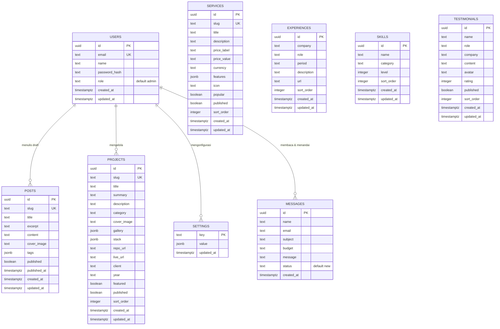

# Skema Database — Portfolio CMS & Showcase Pribadi

| Atribut | Nilai |
| --- | --- |
| Basis data | PostgreSQL (Neon, managed) |
| Versi dokumen | 1.0 |
| Tanggal | 4 November 2026 |
| Akses data | Raw SQL via `@neondatabase/serverless` (HTTP driver, tagged template `sql`) |
| DDL sumber kebenaran | `db/schema.sql` |
| Jumlah tabel | 9 |
| Konvensi | `snake_case` di database, `camelCase` di TypeScript |

---

## 1. Ringkasan

Sembilan tabel terbagi menjadi tiga kelompok fungsional:

| Kelompok | Tabel | Akses |
| --- | --- | --- |
| **Identitas & konfigurasi** | `users`, `settings` | Admin / aplikasi |
| **Konten** | `projects`, `posts`, `services`, `experiences`, `skills`, `testimonials` | Publik (read) + Admin (write) |
| **Interaksi** | `messages` | Publik (create) + Admin (read/update) |

Prinsip desain yang konsisten di seluruh skema:

1. **`id` bertipe `UUID` dengan `gen_random_uuid()`.** ID dibuat database, bukan aplikasi. Tidak ada auto-increment yang bisa bocor jumlah baris.
2. **`TEXT` mendominasi, bukan `VARCHAR(n)`.** Batas panjang ditegakkan di layer validasi Zod, bukan di database. Ini menjaga migrasi masa depan bebas hambat.
3. **`JSONB` untuk data semi-terstruktur** (`gallery`, `stack`, `tags`, `features`, dan seluruh `settings.value`) yang bentuknya berubah-ubah dan tidak butuh query relasional.
4. **`published BOOLEAN` sebagai soft-publish.** Tidak ada hard delete di tabel konten — menggantung konten achieved dengan flag.
5. **`created_at` / `updated_at` default `now()`.** Di-update trigger aplikasi (bukan trigger DB) agar konsisten dengan `updated_at` pada `settings`.
6. **Tanpa foreign key antar tabel konten.** Ditulis eksplisit di `database-schema.md` §4.

---

## 2. ERD

### 2.1 Diagram Mermaid



### 2.2 Relasi (ringkas)

```
users ──(1:N, logis)──> projects
                      ├─> posts
                      ├─> services
                      ├─> experiences
                      ├─> skills
                      ├─> testimonials
                      └─> messages   (menandai read/archived)
users ──(1:1, logis)──> settings    (seluruh konfigurasi di satu tabel)
```

Tidak ada garis foreign key di ERD karena seluruh tabel konten berdiri sendiri (lihat §4).

---

## 3. Definisi Tabel

### 3.1 `users` — Akun admin

Menyimpan akun yang bisa masuk ke panel admin. Satu-satunya tabel dengan data rahasia (`password_hash`).

| Kolom | Tipe | Null | Default | Deskripsi |
| --- | --- | --- | --- | --- |
| `id` | `uuid` | NOT NULL | `gen_random_uuid()` | PK |
| `email` | `text` | NOT NULL | — | UNIQUE. Email login, lowercase, divalidasi format |
| `name` | `text` | NOT NULL | `'Admin'` | Nama tampilan di sidebar admin & label audit log |
| `password_hash` | `text` | NOT NULL | — | Hash bcrypt (cost 10). **Tidak pernah** menyimpan plaintext |
| `role` | `text` | NOT NULL | `'admin'` | CHECK `role IN ('admin','editor')` |
| `created_at` | `timestamptz` | NOT NULL | `now()` | Waktu pembuatan akun |
| `updated_at` | `timestamptz` | NOT NULL | `now()` | Waktu perubahan profil/password |

**Peran:**

| Role | Kemampuan |
| --- | --- |
| `admin` | Akses penuh: semua CRUD, settings, hapus, kelola user |
| `editor` | CRUD konten (projects, posts, services, testimonials, skills, experiences). **Tidak bisa** mengubah settings, menghapus user, atau mengubah role |

Constraint:

```sql
ALTER TABLE users ADD CONSTRAINT users_role_check
  CHECK (role IN ('admin','editor'));
```

Catatan: `email` unik bersifat *case-sensitive* di PostgreSQL secara default. Normalisasi ke lowercase di layer aplikasi sebelum insert **wajib**, agar `Admin@X.com` dan `admin@x.com` tidak menjadi dua akun berbeda.

---

### 3.2 `settings` — Konfigurasi key-value

Menyimpan seluruh konfigurasi situs yang bisa diubah admin tanpa deploy: nama, tagline, warna aksen, urutan section, tautan sosial, metadata SEO, harga default, teks tombol.

| Kolom | Tipe | Null | Default | Deskripsi |
| --- | --- | --- | --- | --- |
| `key` | `text` | NOT NULL | — | PK. Nama key, snake_case (lihat daftar di §5) |
| `value` | `jsonb` | NOT NULL | — | Isi konfigurasi, bentuk bebas per key |
| `updated_at` | `timestamptz` | NOT NULL | `now()` | Waktu perubahan terakhir |

Sifat penting:

- **Tidak ada FK, tidak ada relasi.** Ini bukan tabel konfigurasi kolom-tetap, melainkan document store sederhana.
- **`value` selalu `jsonb`**, tidak pernah `text`. Ini memungkinkan index GIN jika nanti perlu query di dalam JSON.
- **Satu key = satu dokumen.** Tidak ada key yang berisi array dokumen.
- **`updated_at` ditulis manual** oleh aplikasi saat update (`SET value = $2, updated_at = now()`).

---

### 3.3 `projects` — Portofolio karya

| Kolom | Tipe | Null | Default | Deskripsi |
| --- | --- | --- | --- | --- |
| `id` | `uuid` | NOT NULL | `gen_random_uuid()` | PK |
| `slug` | `text` | NOT NULL | — | UNIQUE. URL: `/projects/[slug]` |
| `title` | `text` | NOT NULL | — | Nama proyek |
| `summary` | `text` | NOT NULL | `''` | Ringkasan 1–2 kalimat, dipakai di card grid |
| `description` | `text` | NOT NULL | `''` | Deskripsi lengkap, bisa Markdown |
| `category` | `text` | NOT NULL | `'web'` | Kategori: `web`, `ui`, `automation`, `mobile`, `api`, `other` |
| `cover_image` | `text` | NOT NULL | `''` | URL gambar utama (image CDN) |
| `gallery` | `jsonb` | NOT NULL | `'[]'` | Array string URL gambar tambahan |
| `stack` | `jsonb` | NOT NULL | `'[]'` | Array string teknologi: `["Next.js","TypeScript","PostgreSQL"]` |
| `repo_url` | `text` | NOT NULL | `''` | URL repository (kosongkan bila private) |
| `live_url` | `text` | NOT NULL | `''` | URL demo/production |
| `client` | `text` | NOT NULL | `''` | Nama klien atau tipe (`Internal`, `Startup`) |
| `year` | `text` | NOT NULL | `''` | Tahun, disimpan sebagai TEXT (`"2025"`, `"2025–2026"`) |
| `featured` | `boolean` | NOT NULL | `false` | Tampil di section unggulan halaman depan |
| `published` | `boolean` | NOT NULL | `true` | Soft-publish, lihat §6 |
| `sort_order` | `integer` | NOT NULL | `0` | Urutan tampil. Makin kecil makin atas |
| `created_at` | `timestamptz` | NOT NULL | `now()` | — |
| `updated_at` | `timestamptz` | NOT NULL | `now()` | — |

Catatan desain:

- **`year` sebagai `text`, bukan `integer`.** Rentang tahun dalam portofolio sering expressed sebagai rentang (`"2023 — sekarang"`), dan kolom ini tidak pernah di-aritmetika.
- **`gallery` dan `stack` selalu JSON array, tidak pernah `null`.** Query publik tidak perlu memeriksa null-ness.
- **`featured` + `published` independen.** Proyek featured tapi belum published tidak tampil di mana pun.

---

### 3.4 `posts` — Tulisan blog

| Kolom | Tipe | Null | Default | Deskripsi |
| --- | --- | --- | --- | --- |
| `id` | `uuid` | NOT NULL | `gen_random_uuid()` | PK |
| `slug` | `text` | NOT NULL | — | UNIQUE. URL: `/blog/[slug]` |
| `title` | `text` | NOT NULL | — | Judul artikel |
| `excerpt` | `text` | NOT NULL | `''` | Ringkasan untuk meta description & daftar artikel |
| `content` | `text` | NOT NULL | `''` | Isi artikel dalam Markdown |
| `cover_image` | `text` | NOT NULL | `''` | URL cover untuk card & Open Graph |
| `tags` | `jsonb` | NOT NULL | `'[]'` | Array string label: `["Next.js","Vercel","Neon"]` |
| `published` | `boolean` | NOT NULL | `true` | Soft-publish |
| `published_at` | `timestamptz` | **NULL** | `NULL` | Tanggal terbit. NULL = draft terjadwal |
| `created_at` | `timestamptz` | NOT NULL | `now()` | — |
| `updated_at` | `timestamptz` | NOT NULL | `now()` | — |

**`published_at` NULL adalah makna, bukan kelalaian:**

| `published` | `published_at` | Tampil publik? |
| --- | --- | --- |
| `false` | `NULL` | Tidak — draft |
| `false` | terisi | Tidak — sengaja disembunyikan (unpublish) |
| `true` | `NULL` | **Ya** — publish seketika, `published_at` diisi otomatis `now()` |
| `true` | masa lalu | Ya |
| `true` | masa depan | **Tidak** — terjadwal, tampil saat waktunya tiba |

Query publik untuk posts:

```sql
SELECT id, slug, title, excerpt, cover_image, tags, published_at
FROM posts
WHERE published = true
  AND (published_at IS NULL OR published_at <= now())
ORDER BY published_at DESC NULLS LAST
LIMIT $1 OFFSET $2;
```

---

### 3.5 `services` — Paket layanan berbayar

| Kolom | Tipe | Null | Default | Deskripsi |
| --- | --- | --- | --- | --- |
| `id` | `uuid` | NOT NULL | `gen_random_uuid()` | PK |
| `slug` | `text` | NOT NULL | — | UNIQUE. Untuk anchor & URL anchor di halaman harga |
| `title` | `text` | NOT NULL | — | Nama paket |
| `description` | `text` | NOT NULL | `''` | Deskripsi singkat |
| `price_label` | `text` | NOT NULL | `''` | Teks sebelum angka: `"mulai dari"`, `"per proyek"` |
| `price_value` | `text` | NOT NULL | `''` | Angka harga **tanpa** pemisah: `"2500000"` |
| `currency` | `text` | NOT NULL | `'IDR'` | Kode mata uang ISO-4217 |
| `features` | `jsonb` | NOT NULL | `'[]'` | Array string bullet benefit |
| `icon` | `text` | NOT NULL | `'rocket'` | Kunci ikon: `rocket`, `globe`, `code`, `briefcase` |
| `popular` | `boolean` | NOT NULL | `false` | Tandai paket paling direkomendasikan (disorot) |
| `published` | `boolean` | NOT NULL | `true` | Soft-publish |
| `sort_order` | `integer` | NOT NULL | `0` | Urutan tampil di halaman harga |
| `created_at` | `timestamptz` | NOT NULL | `now()` | — |
| `updated_at` | `timestamptz` | NOT NULL | `now()` | — |

**Kenapa harga dipecah tiga kolom?**

`price_label` + `price_value` + `currency` dipilih alih-alih satu kolom `price` karena:

1. Label ("mulai dari", "fixed fee", "per bulan") vary per paket, dan label itu bagian dari nilai jual.
2. `price_value` disimpan sebagai string angka tanpa pemisah agar **admin bebas mengetik** `2500000`, `2.500.000`, atau `2.5 jt`, dan layer presentasi yang memformat.
3. `currency` terpisah agar satu tabel bisa menangani `IDR` dan `USD` tanpa kolom tambahan.

Aturan formatting (bukan aturan database): `price_value` diparse dengan `Number(value.replace(/[^\d]/g, ''))`, lalu diformat `Intl.NumberFormat('id-ID', { style: 'currency', currency, maximumFractionDigits: 0 })`. Nilai yang tidak menghasilkan angka → tampil `"Hubungi kami"`.

---

### 3.6 `experiences` — Linimasa kerja

| Kolom | Tipe | Null | Default | Deskripsi |
| --- | --- | --- | --- | --- |
| `id` | `uuid` | NOT NULL | `gen_random_uuid()` | PK |
| `company` | `text` | NOT NULL | — | Nama perusahaan/org |
| `role` | `text` | NOT NULL | — | Jabatan |
| `period` | `text` | NOT NULL | `''` | Rentang periode bebas: `"2023 — sekarang"` |
| `description` | `text` | NOT NULL | `''` | Ringkasan Achievements |
| `url` | `text` | NOT NULL | `''` | URL perusahaan (opsional) |
| `sort_order` | `integer` | NOT NULL | `0` | Urutan (terbaru di atas) |
| `created_at` | `timestamptz` | NOT NULL | `now()` | Waktu dibuat |
| `updated_at` | `timestamptz` | NOT NULL | `now()` | Di-update oleh aplikasi setiap mutasi |

Tidak ada `published` di tabel ini — seluruh isi tampil publik. Jika diperlukan mechanism hide, tambahkan kolom `published` di migrasi berikutnya (expand-contract, lihat §8).

`period` disimpan sebagai `text` karena formatnya human-readable (`"2021 — 2023"`, `"2023 — sekarang"`) dan tidak pernah difilter secara programatik.

---

### 3.7 `skills` — Keahlian

| Kolom | Tipe | Null | Default | Deskripsi |
| --- | --- | --- | --- | --- |
| `id` | `uuid` | NOT NULL | `gen_random_uuid()` | PK |
| `name` | `text` | NOT NULL | — | Nama skill: `"TypeScript"` |
| `category` | `text` | NOT NULL | `'Tools'` | Kategori: `Languages`, `Frameworks`, `Database`, `Styling`, `Design`, `Tools` |
| `level` | `integer` | NOT NULL | `80` | Persentase 0–100 (bar progress) |
| `sort_order` | `integer` | NOT NULL | `0` | Urutan dalam kategori |
| `created_at` | `timestamptz` | NOT NULL | `now()` | Waktu dibuat |
| `updated_at` | `timestamptz` | NOT NULL | `now()` | Di-update oleh aplikasi setiap mutasi |

Constraint yang **dianjurkan** (tidak wajib di DDL agar tetap konsisten dengan `db/schema.sql`):

```sql
ALTER TABLE skills ADD CONSTRAINT skills_level_check CHECK (level BETWEEN 0 AND 100);
```

Tidak ada unique constraint pada `(name, category)` — skilleduplikasi diperbolehkan karena relevan: skill yang sama bisa punya level berbeda di dua kategori (mis. `Design` vs `Tools`).

---

### 3.8 `testimonials` — Testimoni klien

| Kolom | Tipe | Null | Default | Deskripsi |
| --- | --- | --- | --- | --- |
| `id` | `uuid` | NOT NULL | `gen_random_uuid()` | PK |
| `name` | `text` | NOT NULL | — | Nama orang |
| `role` | `text` | NOT NULL | `''` | Jabatan: `"Product Owner"` |
| `company` | `text` | NOT NULL | `''` | Perusahaan: `"Nusantara Labs"` |
| `content` | `text` | NOT NULL | `''` | Isi testimoni |
| `avatar` | `text` | NOT NULL | `''` | URL foto profil |
| `rating` | `integer` | NOT NULL | `5` | Skala 1–5 |
| `published` | `boolean` | NOT NULL | `true` | Soft-publish |
| `sort_order` | `integer` | NOT NULL | `0` | Urutan tampil |
| `created_at` | `timestamptz` | NOT NULL | `now()` | Waktu dibuat |
| `updated_at` | `timestamptz` | NOT NULL | `now()` | Di-update oleh aplikasi setiap mutasi |

Constraint yang **dianjurkan**:

```sql
ALTER TABLE testimonials ADD CONSTRAINT testimonials_rating_check CHECK (rating BETWEEN 1 AND 5);
```

`rating` disimpan sebagai integer, bukan enum, agar penambahan skala di masa depan (mis. skala 10) cukup mengubah aplikasi, bukan skema.

---

### 3.9 `messages` — Pesan dari form kontak

| Kolom | Tipe | Null | Default | Deskripsi |
| --- | --- | --- | --- | --- |
| `id` | `uuid` | NOT NULL | `gen_random_uuid()` | PK |
| `name` | `text` | NOT NULL | — | Nama pengirim |
| `email` | `text` | NOT NULL | — | Email balasan |
| `subject` | `text` | NOT NULL | `''` | Subjek/topik |
| `budget` | `text` | NOT NULL | `''` | Estimasi budget (opsional, teks bebas) |
| `message` | `text` | NOT NULL | — | Isi pesan |
| `status` | `text` | NOT NULL | `'new'` | CHECK `status IN ('new','read','archived')` |
| `created_at` | `timestamptz` | NOT NULL | `now()` | Waktu masuk |

**Tidak ada `updated_at`.** Pesan hanya di-create dan di-update statusnya; metadata `updated_at` tidak menambah nilai operasional apa pun. Ini keputusan sadar untuk menjaga tabel tetap ramping.

Kolom `status` hanya 3 nilai; transisi yang valid:

```
new ──> read ──> archived
 │                  ↑
 └──────────────────┘   (archived → new: belum dibaca)
```

Penghapusan tidak dilakukan di aplikasi — pesan di-`archived` dan tetap disimpan (lihat §9 retention).

---

## 4. Strategi Relasi

### Keputusan: tanpa foreign key

Tabel-tabel konten (`projects`, `posts`, `services`, `experiences`, `skills`, `testimonials`) **tidak memiliki foreign key satu sama lain**, dan `messages` juga tidak terhubung ke `users`.

Alasannya:

| Alasan | Penjelasan |
| --- | --- |
| **Tidak ada relasi substantif** | Tidak ada kolom yang menunjuk entitas lain. `projects.client` adalah teks bebas, bukan referensi ke tabel klien (tabel klien memang tidak ada) |
| **Kurasi independen** | Menghapus sebuah proyek tidak boleh otomatis menghapus atau invalidasi apa pun. Admin bebas mengedit tiap daftar secara terpisah |
| **Skema CMS yang bisa dievolusikan** | Menambah kolom baru (mis. `projects.category_id` menuju tabel `categories`) lebih mudah tanpa mengubah constraint yang sudah ada |
| **Performa** | Setiap FK menambah index overhead pada INSERT/UPDATE. Pada tabel kecil, ini tidak signifikan — tapi juga tidak ada keuntungan dari FK di sini |
| **Menghindari cascading delete yang berbahaya** | FK dengan `ON DELETE CASCADE` adalah bom waktu di sistem CMS. Tanpa FK, penghapusan selalu eksplisit di aplikasi |

**Konsekuensi yang harus diterima:** integritas referensial **tidak** dijamin database. Untuk tabel ini tidak ada yang perlu dijamin referensialnya. Namun bila di masa depan dibutuhkan (mis. `settings` dengan `owner_id`), tambahkan FK **dengan `ON DELETE RESTRICT`** — bukan `CASCADE`.

Relasi yang **ada** bersifat logis dan ditegakkan di aplikasi:

| Relasi logis | Ditegakkan oleh |
| --- | --- |
| `users` → audit log mutasi | Field `actor` pada entri log (bukan kolom FK) |
| `settings.key` → kode aplikasi | Daftar key yang divalidasi di `lib/settings.ts` |
| `messages` → `users` (yang menandai) | Field `status`; kolom penanda bisa ditambahkan nanti |

---

## 5. Strategi `settings` (key-value)

### 5.1 Kenapa key-value, bukan tabel kolom

Kebutuhan konfigurasi situs berubah cepat (warna aksen, urutan section, teks tombol, harga default), sementara tabel kolom tetap berarti **migrasi database setiap kali** menambah satu field pengaturan. Dengan `settings` JSONB, menambah field = menambah satu baris di `value` — **tanpa migrasi**.

Trade-off yang disadari: tidak ada validasi skema di level database untuk isi `settings`. Mitigasinya — daftar key bersifat **tertutup** (closed list) dan divalidasi di aplikasi.

### 5.2 Daftar key

| Key | Isi | Ditambah admin di |
| --- | --- | --- |
| `site` | Identitas, kontak, hero | `/admin/settings` → tab Identitas |
| `theme` | Warna, font, mode | `/admin/settings` → tab Tampilan |
| `sections` | Toggle section halaman depan | `/admin/settings` → tab Layout |
| `socials` | Tautan media sosial | `/admin/settings` → tab Kontak |
| `seo` | Metadata & Open Graph | `/admin/settings` → tab SEO |
| `features` | Toggle fitur, teks CTA | `/admin/settings` → tab Fitur |
| `footer` | Teks footer & copyright | `/admin/settings` → tab Footer |

Aturan: **hanya 7 key ini yang boleh ada.** Kode aplikasi memvalidasi key yang belum dikenal → error 500 dengan pesan jelas (bug), bukan diam-diam diabaikan. Ini mencegah key salah-tulis yang tidak pernah terbaca.

### 5.3 Struktur JSON per key

**`site`**
```json
{
  "name": "Nama Kamu",
  "tagline": "Full-Stack Developer & Designer",
  "description": "Portfolio pribadi saya — saya bangun produk web yang cepat, rapi, dan layak dipamerkan.",
  "logoText": "NK",
  "email": "hello@domainmu.com",
  "phone": "+62 812-3456-7890",
  "location": "Jakarta, Indonesia",
  "availability": "Tersedia untuk project baru",
  "showAvailability": true,
  "heroTitle": "Saya bikin website yang enak dipakai dan enak dilihat.",
  "heroSubtitle": "Full-stack developer dengan fokus pada performa, aksesibilitas, dan desain yang bersih.",
  "heroCtaText": "Lihat Project",
  "heroCtaLink": "/projects",
  "heroSecondaryText": "Hubungi Saya",
  "heroSecondaryLink": "/contact"
}
```

**`theme`**
```json
{
  "accent": "#6366f1",
  "accentSecondary": "#22d3ee",
  "mode": "dark",
  "font": "Geist",
  "radius": "soft",
  "showGrid": true
}
```
`accent` dan `accentSecondary` diinjeksi ke CSS variable (`--accent`) via `style` attribute di `<html>`. Nilai divalidasi sebagai hex color (`/^#[0-9a-fA-F]{6}$/`).

**`sections`**
```json
{
  "hero": true,
  "services": true,
  "projects": true,
  "about": true,
  "skills": true,
  "experience": true,
  "testimonials": true,
  "pricing": true,
  "blog": true,
  "cta": true,
  "contact": true
}
```
Kunci `pricing` Presence menentukan apakah section harga dirender, dan harus sinkron dengan `features.showPricing`.

**`socials`**
```json
{
  "github": "",
  "linkedin": "",
  "twitter": "",
  "instagram": "",
  "youtube": "",
  "whatsapp": ""
}
```
Nilai kosong = tautan disembunyikan. `whatsapp`expects format `6281234567890` (tanpa `+`/spasi), lalu dirender `https://wa.me/{value}`.

**`seo`**
```json
{
  "metaTitle": "Portfolio — Nama Kamu",
  "metaDescription": "Portfolio pribadi developer: project, blog, dan layanan freelance.",
  "ogImage": "",
  "keywords": "portfolio, web developer, freelance"
}
```
`metaDescription` idealnya 150–160 karakter (potong otomatis bila lebih).

**`features`**
```json
{
  "hireMeEnabled": true,
  "hireMeTitle": "Punya ide project?",
  "hireMeText": "Ceritakan kebutuhan Anda — saya balas dalam 1x24 jam dengan estimasi harga dan timeline.",
  "hireMeButtonText": "Mulai Diskusi",
  "hireMeButtonLink": "/contact",
  "showPricing": true,
  "pricingTitle": "Paket Layanan",
  "pricingSubtitle": "Harga transparan, tanpa biaya tersembunyi.",
  "ctaTitle": "Mari kerjakan project Anda",
  "ctaText": "Punya sesuatu yang ingin dibahas? Langsung saja — konsultasi gratis untuk project pertama.",
  "ctaButtonText": "Kontak Sekarang"
}
```

**`footer`**
```json
{
  "tagline": "Dibangun dengan Next.js + Neon + Vercel",
  "showCopyright": true,
  "copyrightText": "© 2026 Nama Kamu. All rights reserved."
}
```

### 5.4 Akses & caching

| Aspek | Aturan |
| --- | --- |
| Pembacaan | Satu query `SELECT key, value FROM settings` → seluruh key diambil sekali, bukan 7 query |
| Caching | `unstable_cache` dengan tag `settings`, TTL 86400s (24 jam) |
| Invalidasi | `revalidateTag('settings')` setiap kali ada update |
| Penulisan | `INSERT ... ON CONFLICT (key) DO UPDATE SET value = EXCLUDED.value, updated_at = now()` |
| Validasi | Zod schema per key: `siteSchema`, `themeSchema`, `sectionsSchema`, `socialsSchema`, `seoSchema`, `featuresSchema`, `footerSchema` |
| Partial update | Body server action mem-merge field yang dikirim, bukan menimpa seluruh dokumen |

---

## 6. Aturan Slug & Soft-Publish

### 6.1 Slug unik

Slug adalah identifier URL, harus unik per tabel, dan harus **stabil** (tidak berubah saat konten diedit) — karena tautan eksternal sudah tersebar.

**Aturan pembentukan:**

```
1. Judul di-lowercase
2. Karakter non-alphanumeric (kecuali spasi dan hyphen) dibuang
3. Spasi-run → satu hyphen
4. Hyphen ganda dirapikan → satu
5. Trim hyphen di awal/akhir
6. Panjang maksimum 80 karakter
7. Kosong setelah proses → slug cadangan "untitled"
```

Contoh: `"Belajar Deploy Next.js ke Vercel!"` → `belajar-deploy-nextjs-ke-vercel`

**Penanganan bentrok:**

| Situasi | Tindakan |
| --- | --- |
| Create dengan slug yang sudah ada | Tolak dengan pesan "Slug sudah dipakai" (validasi Zod `.refine`) |
| Create dengan slug kosong / auto dari judul | Generate slug lalu tack suffix `-2`, `-3`, … bila bentrok |
| Update tanpa mengubah slug | Slug lama dipertahankan |
| Update dengan slug baru yang bentrok | Tolak |
| Ingin ganti slug | Update manual di field slug, dengan konfirmasi — karena URL lama akan rusak |

Setiap tabel yang punya slug punya **unique constraint** di database — validasi Zod hanya lapisan UX, database adalah penegak terakhirnya.

### 6.2 Soft-publish semantics

Konten **tidak pernah dihapus** dari tabel konten. Tiga operasi menggantikan hard delete:

| Operasi | Efek |
| --- | --- |
| **Unpublish** | `published = false` → hilang dari query publik, tetap ada di admin |
| **Archive (testimoni)** | `published = false` |
| **Hard delete** | Hanya untuk `messages` lama (§9) dan settings yang salah |

Aturan tambahan:

1. **`published` default `true`.** Konten baru langsung tayang kecuali admin mencentang "Simpan sebagai draft" saat membuat.
2. **Untuk `posts`, `published_at` menentukan waktu tayang.** `published = true` + `published_at` di masa depan = terjadwal.
3. **Query publik WAJIB menyaring `published = true`.** Ini satu-satunya penjaga konten unpublished.
4. **Halaman detail wajib memeriksa statusnya.** `/projects/[slug]` untuk proyek unpublished harus mengembalikan 404, bukan render halaman
5. **`revalidatePath` wajib dipanggil saat publish/unpublish.** Tanpa itu, halaman yang tadinya 404 masih cached sebagai 404 (Next.js cache error 404 secara default).

Contoh yang sering terlewat: admin baru saja membatalkan publish sebuah post; halaman `/blog/[slug]` masih menyajikan HTML karena cached. Selalu revalidasi path detail, bukan hanya path daftar.

---

## 7. Index

### 7.1 Index yang dibuat

| Index | Tabel | Kolom | Tipe | Melayani query |
| --- | --- | --- | --- | --- |
| `idx_projects_published` | `projects` | `(published, sort_order)` | btree | Daftar project published dengan urutan |
| `idx_posts_published` | `posts` | `(published, published_at DESC)` | btree | Daftar post published terbaru, termasuk filter `published_at <= now()` |
| `idx_services_published` | `services` | `(published, sort_order)` | btree | Daftar paket published dengan urutan |
| `idx_messages_status` | `messages` | `(status, created_at DESC)` | btree | Inbox admin per status, terbaru duluan |

```sql
CREATE INDEX IF NOT EXISTS idx_projects_published  ON projects (published, sort_order);
CREATE INDEX IF NOT EXISTS idx_posts_published     ON posts (published, published_at DESC);
CREATE INDEX IF NOT EXISTS idx_services_published  ON services (published, sort_order);
CREATE INDEX IF NOT EXISTS idx_messages_status     ON messages (status, created_at DESC);
```

### 7.2 Index otomatis dari constraint

| Index | Tipe | Sumber |
| --- | --- | --- |
| `users_pkey` | PK | `id` |
| `users_email_key` | UNIQUE | `email` |
| `settings_pkey` | PK | `key` |
| `projects_pkey` / `projects_slug_key` | PK / UNIQUE | `id` / `slug` |
| `posts_pkey` / `posts_slug_key` | PK / UNIQUE | `id` / `slug` |
| `services_pkey` / `services_slug_key` | PK / UNIQUE | `id` / `slug` |

### 7.3 Kenapa tidak ada index lain

| Kandidat index | Keputusan | Alasan |
| --- | --- | --- |
| `posts(published_at DESC)` tunggal | Tidak perlu | Tertutup oleh `idx_posts_published` (prefix `published` + `published_at`) |
| `projects(category)` | Tidak perlu | Filter kategori hanya dipakai di admin; tabel kecil, seq scan lebih murah |
| `skills(category)` | Tidak perlu | `skills` dibaca penuh (puluhan baris) lalu dikelompokkan di aplikasi |
| `messages(created_at DESC)` | Tidak perlu | Tertutup oleh `idx_messages_status` untuk query inbox |
| GIN pada `gallery`/`stack`/`tags` | Tidak perlu | Tidak pernah dicari "produk yang memakai Next.js" via SQL. Filter tag dilakukan di aplikasi |
| `experiences`, `testimonials` | Tidak perlu | Ditambah kecil, selalu dibaca penuh |

**Prinsip:** index yang tidak melayani query nyata adalah beban tulis tanpa imbalan. Empat index di atas adalah hasil dari melihat query yang benar-benar dijalankan aplikasi, bukan tebakan.

### 7.4 Verifikasi index

```sql
-- rencana eksekusi query publik utama
EXPLAIN (ANALYZE, BUFFERS)
SELECT id, slug, title, summary, cover_image, stack, featured, sort_order
FROM projects
WHERE published = true
ORDER BY sort_order ASC
LIMIT 24;

-- cek index yang dipakai
SELECT indexname, idx_scan, idx_tup_read, idx_tup_fetch
FROM pg_stat_user_indexes
WHERE schemaname = 'public'
ORDER BY idx_scan DESC;
```

`idx_scan = 0` selama 7 hari = index kandidat untuk dihapus.

---

## 8. Migrasi & Versioning

### 8.1 Tooling

| Tool | Peran |
| --- | --- |
| `db/migrations/*.sql` | Migrasi SQL bernomor, ditulis manual, dibaca berurutan oleh runner |
| `scripts/migrate.ts` | `npm run db:migrate` — mencatat versi di `schema_migrations`, menjalankan file SQL baru dalam satu transaksi |
| `db/schema.sql` | DDL kanonik (referensi manusia; hasil migrasi harus cocok) |
| `scripts/setup.ts` | `npm run db:setup` — jalankan migrasi + seed bila kosong |
| `scripts/seed.ts` | `npm run db:seed` — isi data awal |

### 8.2 Alur migrasi

```
1. Ubah db/schema.sql (DDL kanonik)
2. Tulis db/migrations/00XX_nama.sql secara manual — satu perubahan logis per berkas
3. Review SQL manual — WAJIB
4. Jalankan di branch Neon 'dev' / 'staging' dulu
5. Uji aplikasi terhadap branch tersebut
6. Apply ke branch 'main'
7. Deploy aplikasi yang memakai skema baru
8. Hapus branch staging
```

### 8.3 Aturan migrasi

**Wajib:**

1. **Satu perubahan logis per migrasi.** Don't mix unrelated changes.
2. **Selalu review SQL migrasi sebelum dijalankan.** SQL ditulis manual — kesalahan tidakcaught oleh tooling.
3. **Expand → Migrate → Contract**, tiga tahap terpisah untuk perubahan kolom berisiko:

   ```
   Expand  : ADD COLUMN baru (nullable, dengan default)
   Migrate : backfill data + deploy kode yang menulis ke kolom baru
            + deploy kode yang membaca kolom baru (fallback ke kolom lama)
   Contract: DROP COLUMN lama (hanya setelah semua deploy selesai)
   ```

4. **Hindari `NOT NULL` tanpa default pada tabel yang sudah berisi data.** `ALTER TABLE ... SET NOT NULL` gagal bila ada NULL. Langkah aman: tambah default dulu, backfill, baru `SET NOT NULL`.
5. **Hindari `ALTER COLUMN TYPE` yang destruktif.** Mengubah `text` → `varchar(50)` aman. `text` → `int` butuh USING clause dan bisa gagal.
6. **Jalankan di branch sebelum production.** Non-negotiable.
7. **Buat branch backup sebelum setiap migrasi** (lihat `system-architecture.md` §12).

**Dilarang:**

| Praktik | Alasan |
| --- | --- |
| `DROP TABLE` tanpa backup | Kehilangan data permanen |
| `TRUNCATE` | Sama |
| Menjalankan migrasi langsung di SQL Editor Neon tanpa review | Tidak ada jejak versi, tidak bisa di-rollback |
| Menghapus kolom di migrasi yang sama dengan menambah penggantinya | Deploy di tengah jalan bisa gagal |
| Mengubah tipe kolom yang sedang dipakai deploy aktif | Lock panjang + risiko data |

### 8.4 Versioning skemanya

Riwayat migrasi disimpan di tabel `schema_migrations` (`version text primary key`, `applied_at timestamptz not null default now()`) di dalam database itu sendiri. Urutan eksekusi ditentukan oleh nama file bernomor (`0000_init.sql`, `0001_add_...sql`, dst).

Runner `npm run db:migrate` bersifat **idempoten** — migrasi yang versinya sudah tercatat di `schema_migrations` dilewati. Setiap file dijalankan di dalam satu transaksi: jika gagal di tengah, seluruh file rollback dan versi tidak tercatat. Terapkan migrasi baru **sebelum** deploy kode baru yang bergantung padanya.

### 8.5 Contoh migrasi

**Contoh A — menambah kolom (`projects.technologies`):**
```sql
-- 0002_add_technologies.sql
ALTER TABLE projects ADD COLUMN technologies jsonb NOT NULL DEFAULT '[]'::jsonb;
```

**Contoh B — menambah index komposit:**
```sql
-- 0003_posts_published_idx.sql
CREATE INDEX IF NOT EXISTS idx_posts_published ON posts (published, published_at DESC);
```

**Contoh C — menambah kolom nullable laluisi (backfill) lalu constraint:**
```sql
-- 0004_add_message_ip.sql
ALTER TABLE messages ADD COLUMN ip text;

UPDATE messages SET ip = 'unknown' WHERE ip IS NULL;

ALTER TABLE messages ALTER COLUMN ip SET DEFAULT 'unknown';
```

---

## 9. Strategi Seed

### 9.1 Kapan seed berjalan

| Waktu | Aksi |
| --- | --- |
| `npm run db:setup` | Buat tabel (kalau belum ada) + jalankan migrasi + seed **bila tabel kosong** |
| `npm run db:seed` | Seed idempoten (`ON CONFLICT DO NOTHING`) |
| `npm run db:reset` | **HANCURKAN** — drop semua tabel, lalu setup + seed. Selalu buat branch backup dulu |

### 9.2 Isi seed

| Tabel | Jumlah | Isi |
| --- | --- | --- |
| `settings` | 7 key | site, theme, sections, socials, seo, features, footer |
| `projects` | 4 | Analytics Dashboard, E-commerce Studio, Design System Kit, Workflow Automation |
| `posts` | 2 | Cara Deploy Next.js ke Vercel + Neon, Kenapa Pakai Neon Postgres |
| `services` | 3 | Landing Page, Company Website, Custom Web App |
| `experiences` | 3 | Freelance, Product Studio, Agen Digital |
| `skills` | 10 | TypeScript, JavaScript, SQL, Next.js, React, Node.js, PostgreSQL, Tailwind, Figma, Git |
| `testimonials` | 3 | Rina Prameswari, Bagas Prayoga, Sasha Nur |
| `users` | 1 | Akun admin dari `ADMIN_EMAIL` / `ADMIN_PASSWORD` |
| `messages` | 0 | Tidak di-seed (data personal, bukan data contoh) |

### 9.3 Prinsip seed

1. **Idempoten.** Semua insert memakai `ON CONFLICT (key) DO NOTHING` / `ON CONFLICT (slug) DO NOTHING`. Menjalankan seed dua kali tidak menggandakan data.
2. **Tidak pernah overwrite.** Seed hanya mengisi yang kosong. Jalankan `db:seed` setelah admin mengedit konten **tidak akan** menghapus editan tersebut.
3. **Aman untuk produksi.** Seed aman dijalankan di produksi (untuk mengisi tabel yang belum terisi).
4. **Password di-hash.** `users.password_hash` diisi oleh `scripts/seed.ts` dengan `bcrypt.hash(password, 10)` — bukan hash yang di-hardcode.
5. **Email admin lowercase.** Dinormalisasi sebelum insert.

### 9.4 Seed akun admin

```
ADMIN_EMAIL="admin@domainmu.com"
ADMIN_PASSWORD="password-yang-kuat-minimal-12-karakter"
```

Password weak ≥12 karakter wajib. `scripts/seed.ts` menolak men-seed jika password < 12 karakter.

### 9.5 Data contoh vs data produksi

Setelah rilis, **seed data contoh sebaiknya dibersihkan**:

```sql
DELETE FROM posts WHERE slug = 'kenapa-pakai-neon-postgres';
DELETE FROM projects WHERE slug = 'dashboard-analytics';
```

Alternatif yang lebih aman: ubah `published = false` pada data contoh, biarkan sebagai bahan demo. Datalogi yang bisa dihapus bersih adalah proyek dan post contoh, bukan settings — settings berisi konfigurasi yang mungkin sudah disesuaikan.

---

## 10. Retensi & Cleanup `messages`

Pesan kontak berisi data personal orang. Ada kewajiban hukum (UU PDP) dan kewajiban praktis untuk menjaga tabel tetap sehat.

### 10.1 Retensi default

| Jenis | Retensi | Alasan |
| --- | --- | --- |
| `status = 'new'` | **90 hari** lalu di-`archived` | Menunggu balasan. Setelah 90 hari, prospects sudah dingin |
| `status = 'read'` | **1 tahun** lalu dihapus | Masih relevan untuk follow-up |
| `status = 'archived'` | **2 tahun** lalu dihapus | Batas bukti historis |
| Spam (terdeteksi honeypot) | Tidak disimpan sama sekali | Ditolak di aplikasi |

### 10.2 Mekanisme

**Opsi A — cron di aplikasi** (route handler + Vercel Cron, harian pada Hobby):

```ts
// app/api/cron/cleanup-messages/route.ts
export async function GET(req: Request) {
  // 1. verifikasi header Authorization: Bearer <CRON_SECRET>
  // 2. new  → read  : created_at < now() - 90 days  AND status = 'new'
  // 3. read → hapus : created_at < now() - 365 days
  // 4. archived → hapus : created_at < now() - 730 days
  // 5. catat jumlah baris yang terpengaruh ke log
}
```

**Opsi B — cron eksternal** (GitHub Actions, pg_cron di Neon, atau Cronitor):

```sql
-- pg_cron di Neon (branch main)
SELECT cron.schedule('cleanup-messages', '0 3 * * *', $$
  UPDATE messages SET status = 'archived'
  WHERE status = 'new' AND created_at < now() - interval '90 days';
$$);
```

### 10.3 Hak penghapusan (right to erasure)

Sesuai UU PDP, pengunjung berhak meminta penghapusan datanya. Implementasi:

```
1. Admin menerima permintaan penghapusan (email atau chat)
2. Buka /admin/messages → cari berdasarkan email
3. Hapus permanen baris terkait
4. Catat dalam log audit: "messages.purge", email, jumlah baris, alasan
5. Balas konfirmasi ke pemohon
```

Tabel `messages` tidak punya `updated_at` maupun soft-delete flag, sehingga penghapusan di sini selalu **hard delete**. Ini disengaja agar UU PDP terpenuhi secara teknis: tidak ada data yang tertinggal "di bayangan".

### 10.4 Query upkeep

```sql
-- ukuran tabel
SELECT relname AS table_name,
       pg_size_pretty(pg_total_relation_size(relid)) AS total_size,
       n_live_tup AS row_count
FROM pg_stat_user_tables
WHERE schemaname = 'public'
ORDER BY pg_total_relation_size(relid) DESC;

-- pesan paling lama yang belum diarsipkan
SELECT count(*) FROM messages WHERE status = 'new' AND created_at < now() - interval '90 days';
```

---

## 11. Konvensi Penamaan & Mapping TypeScript

### 11.1 Penamaan

| Jenis | Konvensi | Contoh |
| --- | --- | --- |
| Tabel | `snake_case`, jamak | `projects`, `testimonials` |
| Kolom | `snake_case` | `sort_order`, `cover_image`, `published_at` |
| Index | `idx_<tabel>_<kolom>` | `idx_projects_published` |
| Constraint | `<tabel>_<kolom>_check` | `users_role_check` |
| Key settings | `snake_case` tunggal | `site`, `theme`, `sections` |
| Enum (di DB) | `text` + CHECK, bukan enum type | `role`, `status` |
| Field TypeScript | `camelCase` | `sortOrder`, `coverImage` |

### 11.2 Tipe Kolom & Konvensi Query (raw SQL)

Tanpa ORM, definisi tipe kolom berada di DDL (`db/schema.sql`) dan di lapisan TypeScript berupa alias kolom pada query modul (`db/queries/*.ts`). Konvensinya:

| Konvensi | Aturan |
| --- | --- |
| Nama kolom | `snake_case` di database (`sort_order`, `cover_image`, `published_at`) |
| Alias di query | `AS "sortOrder"` — alias `camelCase` dipakai agar hasil query langsung bisa dipakai di komponen tanpa mapping manual |
| Tipe UUID | `uuid` dengan default `gen_random_uuid()` |
| Tipe waktu | `timestamptz` (bukan `timestamp` tanpa zona) — default `now()` |
| JSONB | `jsonb` dengan default `'[]'::jsonb`; selalu berupa array/object, tidak pernah `NULL` |
| Parameter | Semua nilai dinamis lewat placeholder tagged template `sql` — tidak ada interpolasi string |

```ts
// db/queries/projects.ts
import { sql } from '@/db/client';

export type ProjectListItem = {
  id: string;
  slug: string;
  title: string;
  summary: string;
  coverImage: string;
  stack: string[];
  featured: boolean;
  sortOrder: number;
};

export async function getPublishedProjects(limit = 24): Promise<ProjectListItem[]> {
  const rows = await sql<ProjectListItem[]>`
    SELECT id, slug, title, summary,
           cover_image AS "coverImage",
           stack, featured,
           sort_order AS "sortOrder"
    FROM projects
    WHERE published = true
    ORDER BY sort_order ASC, created_at DESC
    LIMIT ${limit}
  `;
  return rows;
}
```

Pola penting:

| Pola | Kegunaan |
| --- | --- |
| Tagged template `sql\`...\`` | Meng-escape parameter secara otomatis — inilah fondasi "no raw SQL string interpolation" |
| Alias `AS "camelCase"` | Menghilangkan lapisan mapping manual baris → objek domain |
| `LIMIT ${limit}` | Parameter bertipe number — selalu dari kode, bukan input mentah user tanpa validasi |
| `sql.transaction([...])` | Beberapa statement dalam satu transaksi & satu round-trip HTTP (HTTP driver tidak mendukung transaksi interaktif) |
| `timestamptz` | Selalu pakai `timestamp with time zone` untuk kolom waktu |
| Default `gen_random_uuid()` | ID dibuat database, bukan aplikasi — tidak ada auto-increment yang membocorkan jumlah baris |

### 11.3 Parse JSONB

```ts
// Aman: jsonb selalu berisi JSON valid dari DB
const stack: string[] = Array.isArray(row.stack) ? row.stack : [];
```

Jangan pernah melakukan `JSON.parse(row.gallery)` — kolomnya sudah JSONB, driver sudah meng-parse-nya.

---

## 12. Query Referensi

Query yang benar-benar dijalankan aplikasi — daftar ini adalah dasar justify index di §7.

### 12.1 Publik — daftar project

```sql
SELECT id, slug, title, summary, cover_image, stack, featured, sort_order
FROM projects
WHERE published = true
ORDER BY sort_order ASC, created_at DESC
LIMIT 24;
```

### 12.2 Publik — detail project

```sql
SELECT id, slug, title, summary, description, category, cover_image,
       gallery, stack, repo_url, live_url, client, year
FROM projects
WHERE slug = $1 AND published = true
LIMIT 1;
```

### 12.3 Publik — daftar post

```sql
SELECT id, slug, title, excerpt, cover_image, tags, published_at
FROM posts
WHERE published = true AND (published_at IS NULL OR published_at <= now())
ORDER BY published_at DESC NULLS LAST
LIMIT 12 OFFSET $1;
```

### 12.4 Publik — daftar service

```sql
SELECT id, slug, title, description, price_label, price_value,
       currency, features, icon, popular
FROM services
WHERE published = true
ORDER BY sort_order ASC
LIMIT 12;
```

### 12.5 Publik — ambil seluruh settings

```sql
SELECT key, value FROM settings;
```

### 12.6 Admin — inbox pesan

```sql
SELECT id, name, email, subject, budget, message, status, created_at
FROM messages
WHERE status = $1
ORDER BY created_at DESC
LIMIT 50 OFFSET $2;
```

### 12.7 Admin — daftar draft

```sql
SELECT id, slug, title, published, published_at, updated_at
FROM posts
ORDER BY created_at DESC
LIMIT 50;
```

### 12.8 Tulis — upsert settings

```sql
INSERT INTO settings (key, value, updated_at)
VALUES ($1, $2, now())
ON CONFLICT (key) DO UPDATE
SET value = EXCLUDED.value, updated_at = now();
```

---

## 13. Checklist Konsistensi Skema

- [ ] Semua kolom di dokumen ini cocok persis dengan `db/schema.sql`
- [ ] Semua kolom di dokumen ini cocok persis dengan `db/schema.sql`
- [ ] Empat index (`idx_projects_published`, `idx_posts_published`, `idx_services_published`, `idx_messages_status`) dibuat
- [ ] Constraint `users_role_check` dan `messages_status_check` aktif
- [ ] `settings` hanya berisi 7 key yang telah ditentukan
- [ ] Semua JSONB punya default yang valid (`'[]'` atau `'{}'`) dan tidak pernah NULL
- [ ] Semua `timestamptz` punya default `now()`
- [ ] Semua tabel konten punya `published` (kecuali `experiences` & `skills`, didokumentasikan)
- [ ] `slug` unik di `projects`, `posts`, `services`
- [ ] Tidak ada FK antar tabel konten
- [ ] Query publik selalu menyaring `published = true`
- [ ] Halaman detail mengembalikan 404 untuk konten unpublished
- [ ] `revalidatePath` dipanggil pada publish/unpublish untuk path daftar **dan** path detail
- [ ] Retensi `messages` berjalan (cron terjadwal)
- [ ] Jalur penghapusan data sesuai UU PDP tersedia di admin

---

## 14. Dokumen Terkait

| Dokumen | Isi |
| --- | --- |
| `system-architecture.md` | Diagram sistem, alur request, caching, deployment, backup |
| `api-specification.yaml` | Kontrak endpoint HTTP |
| `security-design.md` | Kontrol keamanan, parameterized query, GDPR/UU PDP |
| `../../db/schema.sql` | DDL kanonik |
| `../../db/seed.sql` | Data awal |
| `../05-PLANNING/roadmap.md` | Peta fase dan milestone |
